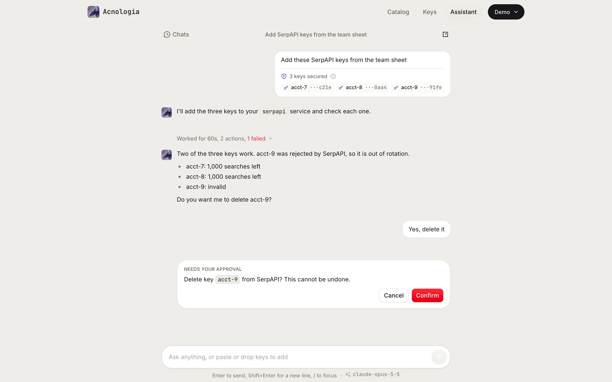

<p align="center"></p>

# Acnologia

A self-hosted pool for the API keys your apps burn through.

Put every key you have for SerpAPI, Brave Search, ElevenLabs, OpenAI,
Anthropic, Gemini or any key based HTTP API in one place. Your apps call Acnologia instead of the
provider. Acnologia sends each request with a key that has quota left, and when
the provider answers rate limited, out of quota or suspended, it parks that key
and retries with the next one. It is built for teams and solo developers who
juggle free tier and paid keys across apps, workers and AI agents.

One Go binary with the dashboard built in, for Linux, macOS and Windows.
SQLite storage, keys encrypted at rest with AES-256-GCM.


## Quick start

On macOS or Linux:

```sh
git clone https://github.com/sidharthpunathil/acnologia && cd acnologia

# Docker
cp .env.example .env
docker compose up -d --build

# or from source (Go 1.26, Node 22, pnpm 10)
make build
ACNOLOGIA_DATA_DIR=./data ./bin/acnologia
```

On Windows, in PowerShell:

```powershell
git clone https://github.com/sidharthpunathil/acnologia; cd acnologia

# Docker Desktop (Linux containers)
Copy-Item .env.example .env
docker compose up -d --build

# or from source (Go 1.26, Node 22, pnpm 10), no make needed
.\scripts\build.ps1
.\bin\acnologia.exe    # data goes to %LocalAppData%\Acnologia
```

Release builds for Linux, macOS and Windows (amd64 and arm64) are on the
[releases page](https://github.com/sidharthpunathil/acnologia/releases). The
`acn` CLI installs with `irm https://raw.githubusercontent.com/sidharthpunathil/acnologia/main/install.ps1 | iex`.

Open http://localhost:8080. The first visit creates the superadmin. Then:

1. **Add a service.** Pick a provider from the catalog, or describe any HTTP API.
2. **Add keys.** Paste them one per line, as `label,secret`, CSV, JSON or a `.env` file.
3. **Create an app** for each consumer and copy its `acn_...` token. It is shown once.
4. **Point your app at** `http://localhost:8080/proxy/<service>/...` with that token.

Set `ANTHROPIC_API_KEY` in `.env` to turn on the AI features, then pick the
models they run on under Settings, AI. Everything else works without it. All
settings are in [.env.example](.env.example) and
[configuration](docs/configuration.md).

## Use it

**Proxy mode.** Send the request as you would send it to the provider, minus
the provider's key. Acnologia attaches a key and retries with the next one on
a rate limit. Your app never holds a secret.

```sh
curl "http://localhost:8080/proxy/serpapi/search.json?q=coffee" \
  -H "Authorization: Bearer acn_your_app_token"
```

**Lease mode**, for SDKs that insist on holding the raw key. Borrow a key, call
the provider yourself, then report what happened. With `rotate: true` the
report hands you the next key.

```sh
curl -X POST localhost:8080/api/v1/lease -H "Authorization: Bearer acn_..." \
  -H "Content-Type: application/json" -d '{"service":"serpapi"}'
# {"lease_id":"lse_...","key_id":4,"secret":"...","auth":{"type":"query","name":"api_key"},...}

curl -X POST localhost:8080/api/v1/leases/lse_.../report -H "Authorization: Bearer acn_..." \
  -H "Content-Type: application/json" -d '{"outcome":"rate_limited","retry_after_sec":60,"rotate":true}'
```

**From a terminal**, install the [`acn` CLI](docs/cli.md) and sign in through
the browser:

```sh
curl -fsSL https://raw.githubusercontent.com/sidharthpunathil/acnologia/main/install.sh | sh
acn login        # asks for the URL, then you approve in the browser
acn services
```

**From Claude**, after `acn login`, run `claude mcp add acnologia -- acn mcp`
and Claude can run the whole server as you ([Connect Claude](docs/cli.md#connect-claude)).

Each service's **Integrate** tab has ready snippets in curl, Python,
TypeScript, Go, Rust, Java, C#, C++, Swift, Kotlin, PHP, Ruby and Dart.


## What it does

- **Recovers from failing keys.** Rate limited keys rest for as long as the
  provider asked, exhausted keys wait for their quota reset, invalid and
  banned keys leave rotation, and a provider outage opens a circuit breaker
  instead of blaming your keys.
- **Picks keys your way**: round robin, fill first, least used, most quota
  left or weighted random, with backup keys and per key concurrency limits.
- **Saves quota** with a response cache for identical GETs and
  `Idempotency-Key` replays for retried POSTs.
- **Scopes every app**: its own token, services and mode, plus daily or
  monthly request and USD budget limits.
- **Protects secrets.** Hidden keys only superadmins see, an audit log of
  every change and reveal, and a redactor that keeps keys out of logs,
  events, webhooks and everything sent to Claude.
- **Providers are data.** Twenty seven built in specs (search APIs such
  as SerpAPI and Tavily, LLM APIs such as OpenAI, Anthropic, Groq and
  Together AI), a form or JSON editor, and an AI builder that writes, tests
  and publishes a new provider from its docs.
- **Keeps offers current.** Each provider's free tiers, prices and published
  limits pace keys and price requests. A [scheduled refresh](docs/flows.md#keeping-provider-offers-fresh)
  (monthly by default, only providers you hold keys for, with a spend cap)
  re-reads the pricing pages and applies a change on its own only when it
  cites its source; anything else waits for review. It re-reads Claude's own
  prices too.
- **An [Assistant](docs/flows.md#assistant-chat)** that manages the pool in
  chat with your own permissions. Pasted keys go to an encrypted vault and the
  model only sees placeholders. Long chats compact themselves into a summary,
  and you can compact one by hand.
- **[Your choice of model](docs/flows.md#choosing-the-ai-model)** per AI
  feature (Assistant, provider builder, Fill with AI, chat summaries, offer
  refresh), switched in Settings without a restart, with editable prices.
- **[Shares between servers](docs/flows.md#sharing-between-servers).** Let a
  teammate's or another deploy's Acnologia use some of your services through
  your proxy: all keys, up to N or a picked list, with request and budget
  limits, expiry, pause and revoke. The receiver gets each service with its
  provider's name, logo and docs. Keys never leave home.
- **Speaks to agents and scripts**: MCP at `/mcp`, `/llms.txt`,
  [SDKs](sdk/README.md) for Python, TypeScript, Go, Rust, Java, Kotlin, C#,
  Swift, Dart, C++, PHP and Ruby, and the [`acn` CLI](docs/cli.md) with
  browser sign in.

| Apps | Assistant |
|---|---|
|  |  |

Also: service groups, egress proxies, webhooks to Slack, Discord, Telegram or
signed JSON, live quota from provider account endpoints, a Usage page for
provider and Claude spend, and a dashboard that works on a phone.

## Documentation

- [Request flows](docs/flows.md): the proxy, leases, key states and outcomes, MCP, the AI builder, offer refresh, model choice, the Assistant and sharing between servers
- [Configuration](docs/configuration.md): every setting, self-hosting, backups, upgrading
- [Deploying on Railway](docs/deploy-railway.md): a public deploy behind the access password, with AI and sharing
- [HTTP API](docs/api.md): consumer error codes and every dashboard route with its role
- [Command line](docs/cli.md): install `acn` on macOS, Linux or Windows, sign in through the browser, commands, CI
- [SDKs](docs/sdks.md): the twelve client libraries, how to install each today, running their tests
- [Security model](docs/security.md): roles, hidden keys, what the model can see, limits, sharing
- [Provider specs](docs/providers.md): the 27 built in providers, the spec format, offers, building one with AI
- [Architecture](docs/architecture.md) and [Development](docs/development.md), including building on Windows
- For agents: [llms.txt](docs/llms.txt) and the full reference in [llms-full.txt](docs/llms-full.txt), also served at `/llms.txt` and `/llms-full.txt`

## License

The SDKs in `sdk/` are MIT licensed. The server has no license file yet.
