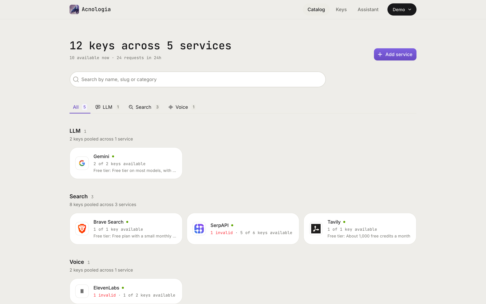
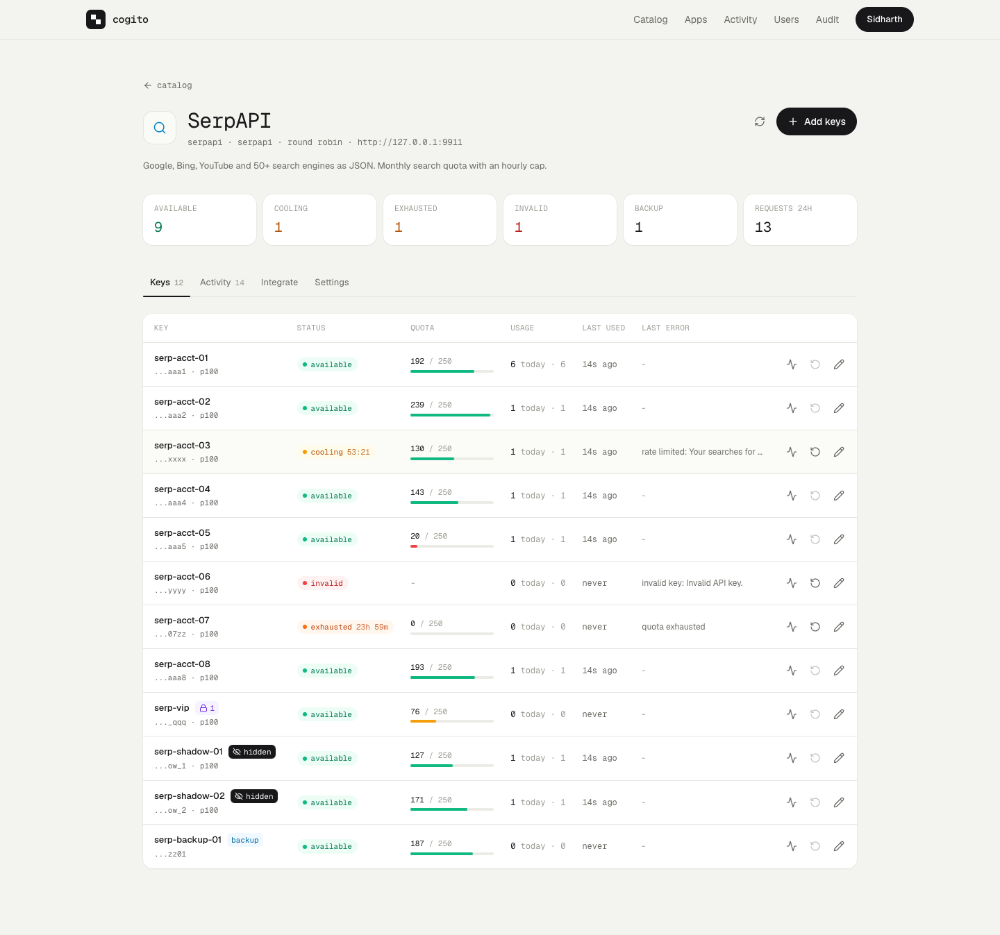
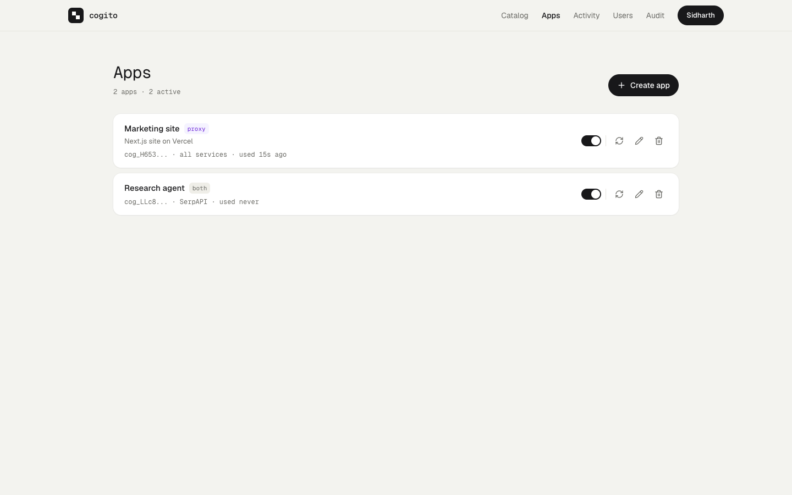

<p align="center"></p>

# Cogito

**I think, therefore I am.**

A self-hosted API key pool. Register many accounts with a provider (SerpAPI,
ElevenLabs, or any API key based HTTP service), put all their keys in Cogito,
and your apps get a working key on demand. When a key hits a rate limit or runs
out of quota, Cogito cools it down and hands out the next one.

One Go binary with an embedded React dashboard. SQLite storage, keys encrypted
at rest with AES-256-GCM.



## Quick start

```sh
# Docker
cp .env.example .env
docker compose up -d --build

# or from source (Go 1.26, Node 22, pnpm 10)
make build
COGITO_DATA_DIR=./data ./bin/cogito
```

Open http://localhost:8080. The first visit creates the superadmin. Then:

1. **Add a service** (SerpAPI, ElevenLabs, or a custom API).
2. **Add keys**: paste one per line, or `label,secret` per line.
3. **Create an app** for each consumer (your website, an agent) and copy its
   `cog_...` token. It is shown once.
4. Point your app at `http://localhost:8080/proxy/<service>/...` with that token.

## Screenshots

| Service keys | Apps |
|---|---|
|  |  |

The service page shows each key's live state: available, cooling with a
countdown, exhausted until reset, or invalid. Badges mark hidden, backup and
restricted keys, and a bar shows quota left.

## Two ways to use it

**Proxy mode (recommended).** Call Cogito instead of the provider. Cogito picks a
key, injects it, retries with the next key on rate limits, and your app never
sees a secret.

```sh
curl "http://localhost:8080/proxy/serpapi/search.json?q=coffee" \
  -H "Authorization: Bearer cog_your_app_token"

curl -X POST "http://localhost:8080/proxy/elevenlabs/v1/text-to-speech/21m00Tcm4TlvDq8ikWAM" \
  -H "Authorization: Bearer cog_your_app_token" \
  -H "Content-Type: application/json" \
  -d '{"text": "Hello", "model_id": "eleven_multilingual_v2"}' -o hello.mp3
```

**Lease mode.** Ask for a key, call the provider yourself, report the outcome.

```sh
curl -X POST localhost:8080/api/v1/lease -H "Authorization: Bearer cog_..." \
  -H "Content-Type: application/json" -d '{"service":"serpapi"}'
# {"lease_id":"lse_...","key_id":4,"secret":"...","auth":{"type":"query","name":"api_key"},...}

curl -X POST localhost:8080/api/v1/leases/lse_.../report -H "Authorization: Bearer cog_..." \
  -H "Content-Type: application/json" -d '{"outcome":"rate_limited","retry_after_sec":60,"rotate":true}'
# {"ok":true,"next":{...a different key...}}
```

## Features

- **Rotation strategies** per service: round robin, fill first (by priority),
  least used today, most quota left, weighted random.
- **Rate limit detection** per provider. SerpAPI: out of searches, hourly cap,
  invalid key. ElevenLabs: quota exceeded, concurrency limit, invalid key, and
  `system_busy` (provider side, so the key is not penalized). Generic: 429, 402,
  401/403 and `Retry-After`.
- **Cooldown with backoff**: `Retry-After` when given, otherwise the service
  cooldown doubled per consecutive failure, capped at one hour. A key that is
  only `busy` (at its concurrency cap) steps aside for a second without
  backoff. A key whose account was suspended is marked `banned` and stays out
  until you reset it.
- **Circuit breaker** per service: when the provider itself keeps failing
  (5xx, timeouts), Cogito pauses traffic, answers 503 at once, and probes
  until it recovers. Keys are not blamed for a provider outage.
- **Quota tracking**: health checks read SerpAPI `account.json` and ElevenLabs
  `/v1/user/subscription` (neither spends quota), and providers that report
  quota in response headers (Brave Search) update it on every request.
  Exhausted keys come back automatically when the quota resets.
- **Response cache**: identical GET requests to search style APIs are
  answered from memory, so repeats spend no quota. `Idempotency-Key` makes
  retried POSTs safe.
- **Service groups**: put several services behind one slug and Cogito falls
  through to the next when one runs dry or goes down.
- **App limits and spend**: per app daily and monthly request caps and USD
  budgets, with spend tracked from each provider's price per request.
- **Egress proxies**: route a service or a single key through an HTTP, HTTPS
  or SOCKS5 proxy.
- **Webhooks** to Slack, Discord, Telegram or any URL (signed JSON) when a key
  goes bad, quota runs low, a pool runs dry or a provider goes down.
- **Catalog** with SerpAPI, ElevenLabs, Serper, Brave Search, Tavily, Exa,
  Firecrawl, Jina, SearchApi, Linkup and You.com built in.
- **Key flags**:
  - `hidden`: only superadmins see the key or count it, and admins cannot
    infer it from events. Hidden keys are used (leased or proxied) only by
    apps a superadmin marked `lease_hidden`, and are never sent to a service
    whose base URL or auth was last changed by someone other than a
    superadmin. See [security](docs/security.md).
  - `backup` tier: used only when every primary key is unavailable.
  - `restricted`: only allow-listed apps can use it.
  - `disabled`: kept, but never handed out.
- **Roles**:
  - `member`: read only.
  - `admin`: manages services, keys and apps. Admins can create lease apps,
    so treat non-hidden keys as readable by admins; use `hidden` for keys
    they must never see.
  - `superadmin`: everything above, plus hidden keys, revealing secrets,
    users and the audit log.
- **Apps**: each consumer gets its own token (shown once, stored as a hash),
  limited to `proxy`, `lease` or both, and to a list of services. Apps only ever
  learn whether a key is available, never how many exist.
- **MCP server** at `POST /mcp` (streamable HTTP) with tools `list_services`,
  `pool_status`, `get_key`, `report_key`, `proxy_request`.
- **llms.txt** at `/llms.txt`, full version in `docs/llms-full.txt`.
- **SDKs**:
  - Python: [`sdk/python`](sdk/python)
  - TypeScript and JavaScript: [`sdk/typescript`](sdk/typescript)
  - Go: [`sdk/go`](sdk/go)
  - PHP: [`sdk/php`](sdk/php)
  - Ruby: [`sdk/ruby`](sdk/ruby)
- **Audit log** of every dashboard change and every secret reveal.
- **Admin API tokens and `cogito ctl`**: scoped `cogadm_` tokens for scripts
  and CI, and a command line client in the same binary
  (`cogito ctl login`, `status`, `keys add`, `keys check`, `events`, ...).

## Providers are data, and AI builds them

A provider (SerpAPI, ElevenLabs, anything else) is a JSON spec stored in SQLite:
where the key goes, which error responses mean "rate limited", "out of quota"
or "bad key", how to read remaining quota, and fixture tests that prove the rules
work. One engine interprets every spec. Publishing a spec swaps it in memory, so
**adding or fixing a provider never restarts Cogito**.

**Build with AI.** Give it a name, a docs URL or a GitHub repo (and optionally a
test key). An agent built on the Claude API then:

1. researches the official docs (web search, web fetch, GitHub),
2. writes the whole provider: metadata, brand color, auth, defaults, rules,
   health check, examples and tests,
3. validates it and runs the fixture tests through the real engine, plus a live
   check when you gave a test key,
4. finds the logo on the provider's website,
5. publishes it and adds a service to the catalog.

You watch every step live in the dashboard. Without auto publish, the draft
waits for your review.

**Guardrails are enforced in code, not just requested in the prompt:**
- Specs are data and cannot execute.
- The harness re-validates and re-tests every submit itself.
- A failing test blocks publishing.
- Logo and live-check requests can't reach private networks.
- Test keys are encrypted and wiped after the run.
- Runs are capped in turns and searches.

**AI rules** (Settings) is your own policy text that every AI action follows,
for example "always set max_concurrency for voice APIs".

**Fill with AI** fills the app, service and provider forms from one sentence.

Every provider has version history and one-click rollback. You can edit it in
the dashboard as a form or as raw JSON, with live validation.

Set `ANTHROPIC_API_KEY` in `.env` to turn the AI features on; everything else
works without it.

## Private by default

Every response carries `X-Robots-Tag: noindex, nofollow`, and `/robots.txt`
disallows everything, so search engines and AI crawlers stay out. Pages also
cannot be framed.

## Self-hosting

```sh
cp .env.example .env
docker run --rm cogito:latest gen-master-key   # paste into COGITO_MASTER_KEY
docker compose up -d --build
open http://localhost:8080                      # first visit creates the superadmin
```

Back up the `cogito-data` volume **and** your master key. Without the master key,
stored API keys cannot be decrypted. If `COGITO_MASTER_KEY` is unset, one is
generated into `/data/master.key` on first boot.

Put it behind TLS (Caddy, Traefik, Cloudflare Tunnel) and set
`COGITO_SECURE_COOKIES=true`. Behind a reverse proxy also set
`COGITO_TRUST_PROXY_HEADERS=true`, or every client shares one login rate
limit. All settings are in [.env.example](.env.example).

Upgrading: existing apps can no longer lease or proxy hidden keys until a
superadmin turns on **Lease hidden keys** for them, because a lease or an
echoing upstream reveals the plain key.

## MCP

Claude Code:

```sh
claude mcp add --transport http cogito http://localhost:8080/mcp \
  --header "Authorization: Bearer cog_your_app_token"
```

Any MCP client that supports streamable HTTP with a bearer header works the same way.

## Development

```sh
make dev    # Go on :8080, Vite on :5173 with hot reload
make test   # Go tests with the race detector
make build  # bin/cogito with the UI embedded
```

Layout:

| Path | What |
|---|---|
| `server/` | Go backend: `internal/api` (HTTP, proxy, MCP), `pool` (selection, slots, outcomes), `providers` (spec engine), `catalog` (provider publishing, logos), `agent` (AI builder), `store` (SQLite), `worker` (health checks, housekeeping) |
| `web/` | React, Vite, Zustand and Tailwind dashboard |
| `sdk/` | Client libraries |
| `docs/` | Architecture, flows, security, configuration, API, llms.txt |
| `reference/` | Third party code used as reference only |

Providers are data, not code: add one from the dashboard, with the AI
builder, or through the API. See [docs/providers.md](docs/providers.md).

## Documentation

- [Architecture](docs/architecture.md): components, data model, boot and background work
- [Request flows](docs/flows.md): proxy, leases, key states, health checks, sign in, MCP, AI builder
- [Security model](docs/security.md): roles, hidden keys, secrets, limits, operator checklist
- [Configuration](docs/configuration.md): every setting, backups, upgrading
- [HTTP API](docs/api.md): consumer error codes and the dashboard API
- [Provider specs](docs/providers.md) and [Development](docs/development.md)
