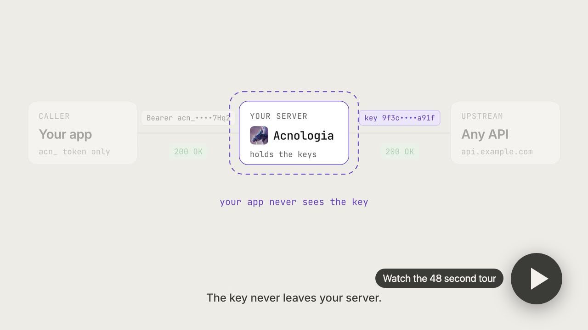

<p align="center"></p>

# Acnologia

Share your API keys without giving them away.

<p>
  <a href="https://github.com/sidharthpunathil/acnologia/actions/workflows/ci.yml"></a>
  <a href="https://github.com/sidharthpunathil/acnologia/releases"></a>
  
  
  <a href="LICENSE"></a>
  
</p>

<p align="center">
  <a href="https://github.com/sidharthpunathil/acnologia/raw/main/video/acnologia-web.mp4"></a>
</p>

API keys get passed around in `.env` files, chat messages and CI settings.
Once a key is out, you cannot take it back, you cannot see who is using it,
and the only way to stop them is to rotate it for everyone.

Acnologia is a self-hosted key server. You add your keys once. Every app,
script, AI agent, teammate or other server gets its own token and calls the
API through Acnologia, which attaches the key on the way out. You decide
which keys each one may use, how much, and for how long, and you can revoke
any of them in one click without touching the key itself.

One Go binary with the dashboard built in, for Linux, macOS and Windows.
SQLite storage, keys encrypted at rest with AES-256-GCM.

## Who you can share with

| Share with | What they get | What they see |
|---|---|---|
| An app or script | Its own `acn_` token for the proxy | Nothing but responses |
| An AI agent | The same token over MCP at `/mcp`, or plain HTTP | Nothing but responses |
| A person who does not run Acnologia | A one time link, then a personal token, ready made snippets and a My access page | Nothing but responses |
| Another Acnologia server | An invite bound to that server's identity | Nothing, in proxy mode |

In proxy mode the key never leaves your server, so revoking a share stops the
next request. For the cases where the other side needs the raw key there are
explicit modes: lease (an app borrows a key for a short time), handover (keys
sealed to another server, deleted there when the share ends) and reveal (a
person sees the keys once). Acnologia marks every key that left this way, and
when such a share ends it lists exactly which keys to rotate.

## Control every share

- **Pick the keys.** All of a service's keys, up to N of them, or a hand
  picked list.
- **Set limits.** Daily or monthly request caps and a USD budget per app or
  share, reserved before each call so a burst cannot overshoot them.
- **Set a timer.** End a share after an hour, a day, a week or at a set time,
  and choose whether it expires (you can extend it) or is revoked for good.
- **Pause, resume, revoke.** Each takes effect on the next request.
- **See the use.** Requests, spend and last use per share, and an audit log
  of every change and every reveal.

## Keys that keep working

Sharing a pool of keys only helps if the pool stays healthy, so Acnologia
looks after it:

- A rate limited key rests for as long as the provider asked, a key out of
  quota waits for its reset, and a revoked or suspended key leaves rotation
  once a health check confirms it. An outage at the provider opens a circuit
  breaker instead of blaming your keys.
- Keys are picked round robin, fill first, least used, most quota left or
  weighted random, with backup keys and per key concurrency limits.
- Identical GET requests can be answered from a response cache, and retried
  POSTs with an `Idempotency-Key` are replayed instead of sent twice.

## Quick start

On macOS or Linux:

```sh
git clone https://github.com/sidharthpunathil/acnologia && cd acnologia

# Docker
cp .env.example .env
docker compose up -d --build

# or from source (Go 1.26, Node 22, pnpm 10)
make build
ACNOLOGIA_DATA_DIR=./data ./bin/acnologia
```

On Windows, in PowerShell:

```powershell
git clone https://github.com/sidharthpunathil/acnologia; cd acnologia

# Docker Desktop (Linux containers)
Copy-Item .env.example .env
docker compose up -d --build

# or from source (Go 1.26, Node 22, pnpm 10), no make needed
.\scripts\build.ps1
.\bin\acnologia.exe    # data goes to %LocalAppData%\Acnologia
```

Release builds for Linux, macOS and Windows (amd64 and arm64) are on the
[releases page](https://github.com/sidharthpunathil/acnologia/releases).

Open http://localhost:8080. The first visit creates the superadmin. Then:

1. **Add a service.** Pick one from the built in catalog, or describe any
   HTTP API that takes a key in a header or a query parameter.
2. **Add keys.** Paste them one per line, as `label,secret`, CSV, JSON or a
   `.env` file.
3. **Share them.** Create an app and copy its `acn_` token (shown once), or
   open Sharing to send a link to a person or an invite to another server.
4. **Call through the proxy** at `http://localhost:8080/proxy/<service>/...`
   with that token.

The AI features (an assistant that manages the server in chat, a builder that
turns API docs into a provider spec, and a monthly refresh of provider prices
and limits) need `ANTHROPIC_API_KEY` in `.env`. Everything else works without
it. Every setting is in [.env.example](.env.example) and
[configuration](docs/configuration.md).

## Deploy

Run it anywhere a container or a Linux machine runs. Each guide ends with
the server behind HTTPS and the access password, so it never comes up open.

- [Every option](docs/deploy.md): one click on a hosting platform (the
  repository carries [render.yaml](render.yaml), [fly.toml](fly.toml) and
  [.railway/railway.ts](.railway/railway.ts)), the container image
  `ghcr.io/sidharthpunathil/acnologia` for amd64 and arm64, and the settings
  a public deploy needs
- [A hosted deploy, step by step](docs/deploy-railway.md), with a volume
- [Any Linux server](docs/deploy-vps.md): one command sets up Docker, the
  server and an HTTPS certificate, and a rerun upgrades it:

  ```sh
  curl -fsSL https://raw.githubusercontent.com/sidharthpunathil/acnologia/main/deploy/install-server.sh \
    | sudo bash -s -- --domain key.example.com --email you@example.com
  ```

  Paste [deploy/cloud-init.yaml](deploy/cloud-init.yaml) as user data to do
  the same when you create a server on any cloud, or create one from your
  machine with the scripts in [deploy](deploy).

## Use it

**Proxy.** Send the request you would send to the API, minus the key.
Acnologia attaches one, and retries with the next key if the first is rate
limited.

```sh
curl "http://localhost:8080/proxy/weather/v1/forecast?city=Lisbon" \
  -H "Authorization: Bearer acn_your_app_token"
```

**Share with a person.** In Sharing, choose New share, then A person. Pick
the services, keys, limits and end time, and send them the one time link.
They open it, get a personal token with copy and paste snippets and an MCP
setup for their agent, and can check what they have left at `/me`.

**Share with another server.** Each server has an id and a key pair. Create
an invite in Sharing and paste it on the other server: its services appear
there and call through yours.

**Lease**, for SDKs that insist on holding the raw key. Borrow a key, call the
API yourself, then report what happened. With `rotate: true` the report hands
you the next key.

```sh
curl -X POST localhost:8080/api/v1/lease -H "Authorization: Bearer acn_..." \
  -H "Content-Type: application/json" -d '{"service":"weather"}'

curl -X POST localhost:8080/api/v1/leases/lse_.../report -H "Authorization: Bearer acn_..." \
  -H "Content-Type: application/json" -d '{"outcome":"rate_limited","retry_after_sec":60,"rotate":true}'
```

**From a terminal**, install the [`acn` CLI](docs/cli.md) and sign in through
the browser:

```sh
curl -fsSL https://raw.githubusercontent.com/sidharthpunathil/acnologia/main/install.sh | sh
acn login        # asks for the URL, then you approve in the browser
acn services
```

On Windows: `irm https://raw.githubusercontent.com/sidharthpunathil/acnologia/main/install.ps1 | iex`.

Each service's **Integrate** tab has ready snippets in curl, Python,
TypeScript, Go, Rust, Java, C#, C++, Swift, Kotlin, PHP, Ruby and Dart, and
there are [SDKs](sdk/README.md) for the same twelve languages.

## Also included

- **Hidden keys** only superadmins can see or route, and a redactor that keeps
  keys out of logs, events, webhooks and anything sent to the AI model.
- **An access password** that locks a public deploy before anyone reaches
  the sign in page.
- **Providers as data.** Built in specs for common search and AI APIs, a form
  or JSON editor for your own, and an AI builder that writes, tests and
  publishes a spec from an API's docs.
- **Service groups, egress proxies, signed webhooks**, live quota from
  provider account endpoints, a Usage page, and a dashboard that works on a
  phone.

## Documentation

- [Request flows](docs/flows.md): the proxy, leases, key states, MCP, sharing, the AI builder, offer refresh and the assistant
- [Security model](docs/security.md): roles, hidden keys, what each kind of share can see, what the model can see
- [Configuration](docs/configuration.md): every setting, self-hosting, backups, upgrading
- [Deploying](docs/deploy.md): every way to run a public server, with [Railway](docs/deploy-railway.md) and [any Linux server](docs/deploy-vps.md) step by step
- [HTTP API](docs/api.md): consumer error codes and every dashboard route with its role
- [Command line](docs/cli.md) and [SDKs](docs/sdks.md)
- [Provider specs](docs/providers.md): the spec format, offers, building one with AI
- [Architecture](docs/architecture.md) and [Development](docs/development.md)
- For agents: [llms.txt](docs/llms.txt) and [llms-full.txt](docs/llms-full.txt), also served at `/llms.txt` and `/llms-full.txt`

## Contributing

Issues and pull requests are welcome. Read [CONTRIBUTING.md](CONTRIBUTING.md)
to set up a dev environment and run the tests, and report security problems
privately as described in [SECURITY.md](SECURITY.md). If Acnologia is useful
to you, a star helps other people find it.

## License

[MIT](LICENSE). The server, the dashboard, the CLI and the SDKs are all
released under the MIT license.

Product and company names that appear in the built in provider catalog belong
to their owners. Acnologia is not affiliated with or endorsed by any of them.
