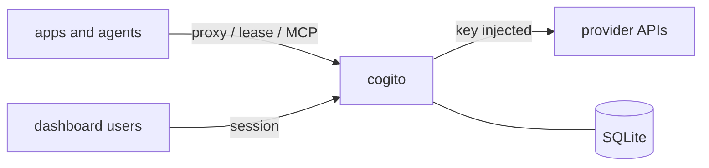

# Cogito docs

| Doc | For | Covers |
|---|---|---|
| [Architecture](architecture.md) | contributors, operators | Components, packages, middleware pipeline, data model, boot, background work, build and deployment. |
| [Request flows](flows.md) | contributors | Sequence and state diagrams: proxy, key selection, lease and report, key states, classification, health checks, sign in, MCP, AI builder. |
| [Security model](security.md) | operators, reviewers | Roles, hidden keys, secrets at rest, web protections, limits, outbound requests, checklist. |
| [Configuration](configuration.md) | operators | Environment variables, service settings, running, backups, upgrading. |
| [HTTP API](api.md) | integrators | Consumer error codes and the full dashboard API with required roles. |
| [Provider specs](providers.md) | admins, contributors | How providers are defined, published, versioned and added. |
| [Development](development.md) | contributors | Setup, layout, tests, conventions. |
| [llms.txt](llms.txt) / [llms-full.txt](llms-full.txt) | app and agent authors | Consumer API, proxy, MCP and SDK usage. |

Design history lives in [`superpowers/specs`](superpowers/specs): the original
key pool design and the providers as data and AI builder design.

