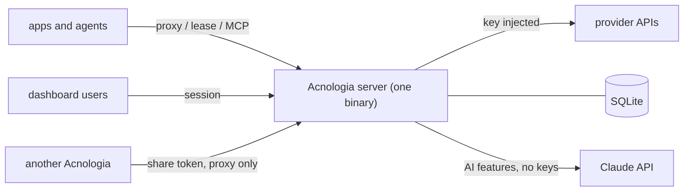

# Acnologia docs

| Doc | For | Covers |
|---|---|---|
| [Architecture](architecture.md) | contributors, operators | Components, packages, middleware pipeline, data model, boot, background work, build and deployment. |
| [Request flows](flows.md) | contributors | Sequence and state diagrams: proxy, key selection, lease and report, key states and outcomes, classification, health checks, sign in, MCP, AI builder, offer refresh, AI model choice, Assistant and compaction, sharing between servers. |
| [Security model](security.md) | operators, reviewers | Roles, key flags, hidden keys, what the model can see, secrets at rest, web protections, limits, outbound requests, AI models and refresh, sharing, checklist. |
| [Configuration](configuration.md) | operators | Environment variables, service settings, self-hosting, Windows, backups, upgrading. |
| [Deploying on Railway](deploy-railway.md) | operators | A public deploy behind the access password, AI, sharing, backups. |
| [HTTP API](api.md) | integrators | Consumer error codes and every dashboard route with its required role. |
| [Command line](cli.md) | operators, CI | Installing `acn` (macOS, Linux, Windows), browser sign in, every command, CI variables, the device flow. |
| [SDKs](sdks.md) | app authors | The twelve client libraries, installing each today, the shared surface, running their tests. |
| [Provider specs](providers.md) | admins, contributors | The 27 built in providers, the spec format, offers and their refresh, providers from another server, the AI builder, live checks. |
| [Development](development.md) | contributors | Setup, layout, tests, CI, building on Windows, screenshot tests, conventions. |
| [llms.txt](llms.txt) / [llms-full.txt](llms-full.txt) | app and agent authors | Consumer API, proxy, MCP, SDKs, redaction guarantees and errors. |

Design history lives in [`superpowers/specs`](superpowers/specs): the original
key pool design, the providers as data and AI builder design, and the server
identity and sharing design.

