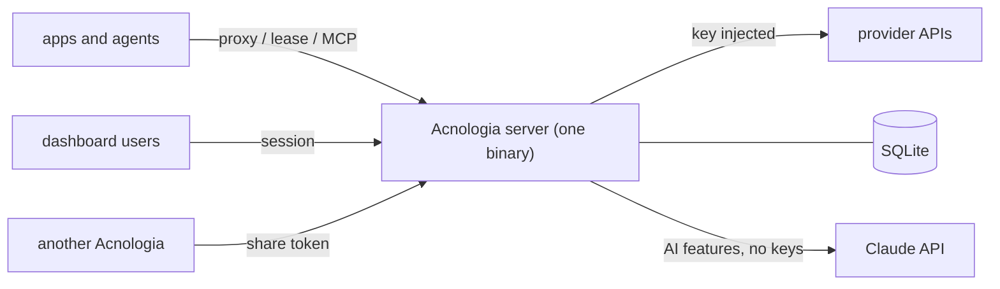

# Acnologia docs

Start with the [README](../README.md) for what Acnologia does and how to run
it. Each doc below answers one kind of question.

| Doc | For | What you find there |
|---|---|---|
| [Architecture](architecture.md) | contributors, operators | The packages, the middleware every request passes, which routes take which credential, the data model, boot, background loops, build and deployment shape. |
| [Request flows](flows.md) | contributors | Sequence and state diagrams: a proxied request, key selection, lease and report, key states, response classification, health checks, sign in, the app and control MCP, the AI builder, model choice, offers refresh, the Assistant, sharing with servers and with people. |
| [Security model](security.md) | operators, reviewers | Roles, key flags, hidden keys, what the model can see, secrets at rest, web protections, abuse limits, outbound requests, sharing, an operator checklist and known limitations. |
| [Configuration](configuration.md) | operators | Every environment variable, per service settings, running and self-hosting, Windows, the access password, backups and upgrades. |
| [Deploying](deploy.md) | operators | Every deploy option: one click on Render or Railway, Fly.io, or the container image. |
| [Deploying on Railway](deploy-railway.md) | operators | A step by step public deploy on Railway behind the access password, with AI, backups and the master key. |
| [Deploying on a VPS](deploy-vps.md) | operators | One script for any Linux server with HTTPS, cloud-init, and a one command setup on Hetzner or DigitalOcean. |
| [HTTP API](api.md) | integrators | Consumer error codes, and every dashboard route with the role it needs. |
| [Command line](cli.md) | operators, CI | Installing `acn` on macOS, Linux and Windows, browser sign in, every command, CI variables and the device flow. |
| [SDKs](sdks.md) | app authors | The seventeen client libraries, how to install each, the surface they share and how to run their tests. |
| [Provider specs](providers.md) | admins, contributors | The 27 built in providers, the spec format, offers and their refresh, usage guides, the AI builder, providers from another server and live checks. |
| [Development](development.md) | contributors | Clone to tests and a running dashboard, the repository layout, every test suite, CI, Windows builds, screenshot tests and conventions. |
| [llms.txt](llms.txt) / [llms-full.txt](llms-full.txt) | app and agent authors | The consumer API, proxy, MCP, SDKs, redaction guarantees and errors, written for a model to read. |

Design history lives in [`superpowers/specs`](superpowers/specs): the original
key pool, providers as data and the AI builder, the control MCP, server
identity and sharing, share modes and timers, and sharing with people.

