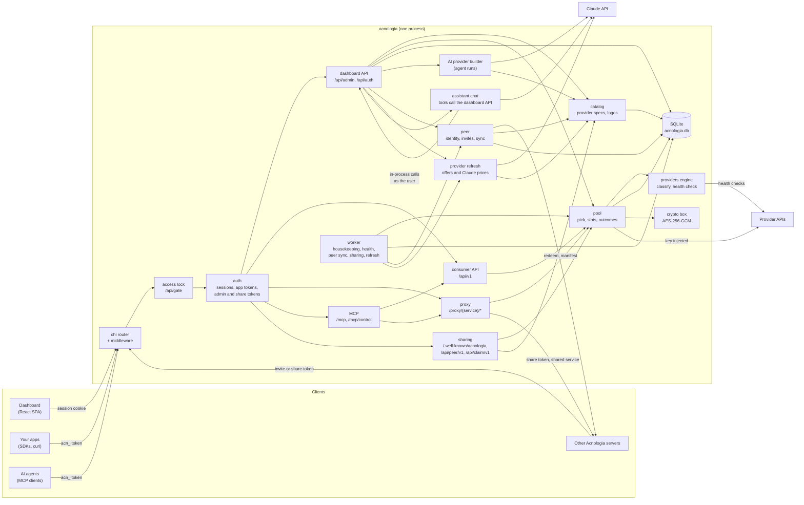
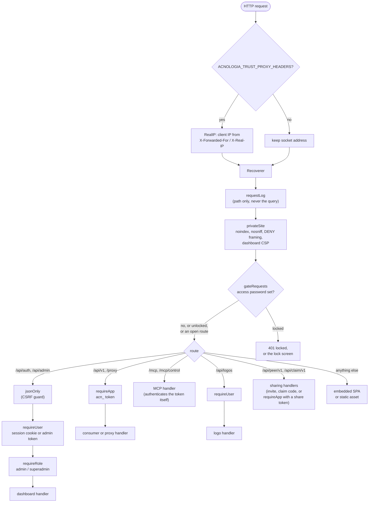
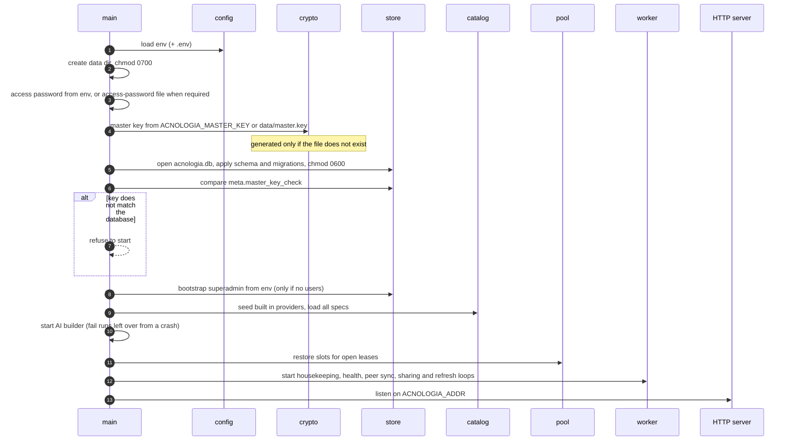
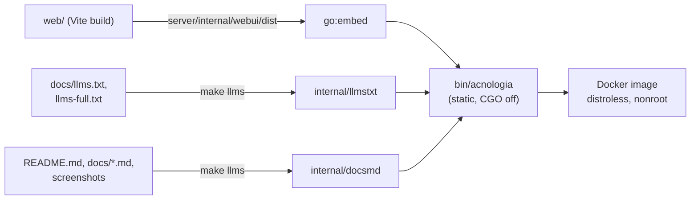
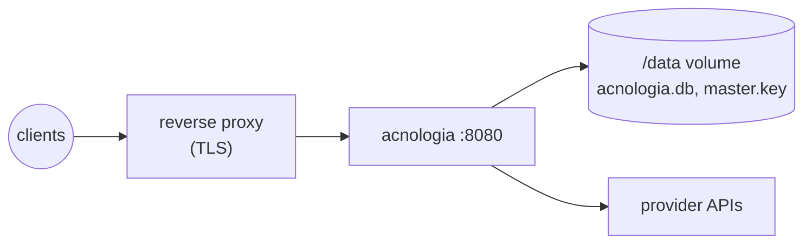

# Server architecture

Acnologia is one Go binary backed by one SQLite file. A single process serves
the React dashboard, the dashboard API, the consumer API, the HTTP proxy, the
app and control MCP endpoints and the routes other servers use for sharing.
There is no queue, cache server or second service to run.

## Packages

All server code lives under `server/`. The HTTP handlers are listed file by
file in the next section.

| Package | Responsibility |
|---|---|
| `cmd/acnologia` | Entry point and boot sequence. Subcommands: `acnologia version`, `acnologia gen-master-key`, `acnologia mcp` (a stdio bridge to `/mcp`, or to `/mcp/control` with `--control` or an `acnadm_` token) and `acnologia ctl`. |
| `cmd/acn` | The `acn` command line client. |
| `internal/config` | Reads `ACNOLOGIA_*` environment variables and an optional `.env` file, picks the default data directory per OS and manages the generated `access-password` file. See [configuration](configuration.md). |
| `internal/api` | Every HTTP handler, the router and its middleware. See [Inside internal/api](#inside-internalapi). |
| `internal/pool` | Picks a key for a request, holds per key concurrency slots (`slots.go`), paces keys under the limits their provider publishes (`pacer.go`), applies outcomes (cooldown, exhausted, invalid, banned) and runs health checks. `corroborate.go` stops one caller's request shape from marking a working key as rejected. |
| `internal/providers` | The provider spec format and engine: classifying upstream responses into outcomes, reading quota headers, running health checks, auth placement, offers, usage guides, fixture tests and the 27 built in specs (`builtin*.go`). |
| `internal/catalog` | Provider records on top of the store: validation, publishing with version history, service defaults, live checks, logo discovery and the SSRF safe HTTP client (`SafeClient`, with the address rules in `netguard.go`). |
| `internal/agent` | The shared Claude client and everything that calls it: the AI provider builder (a background run that drives Claude with tools to research a provider and produce a spec), Fill with AI (`assist.go`), the Assistant and its compaction summaries (`chat.go`), usage guide writing (`guide.go`), and the offers and Claude price research the refresh calls (`refresh.go`). Also the model per feature and price overrides (`models.go`, `pricing.go`, `prices.go`). |
| `internal/refresh` | The provider offers refresh: settings and schedule (`settings.go`, `schedule.go`), runs that re-check each provider's offers and Claude's prices within a budget (`refresher.go`), and the offers diff that decides between publishing and a review (`diff.go`). See [flows](flows.md#keeping-provider-offers-fresh). |
| `internal/peer` | Sharing between servers: the server identity (Ed25519, `identity.go`), invites and the signed redeem message (`invite.go`), the server to server client (`client.go`), the receiver's sync that turns a share's manifest into local services and imports the provider specs they need (`sync.go`, `providers.go`), and key handover: sealing keys to the receiver with HPKE (`box.go`) and the owner and receiver sides (`handover.go`, `handover_sync.go`). See [flows](flows.md#sharing-between-servers). |
| `internal/store` | SQLite persistence: schema, migrations and one file per entity. |
| `internal/crypto` | The master key, AES-256-GCM encryption of secrets (`Box`), keyed fingerprints for duplicate detection, token hashing and secret scrubbing (`Scrub`). |
| `internal/redact` | Keeps secrets out of everything that is not the key store: requests to Claude, agent steps, events, the audit log, webhook payloads and log lines. See [security](security.md#what-the-model-can-and-cannot-see). |
| `internal/keyparse` | Pulls keys out of pasted or dropped text: JSON arrays, CSV with a header row, `.env` files and free form lists. |
| `internal/breaker` | The per service circuit breaker that pauses traffic to a provider that keeps failing. |
| `internal/respcache` | The in-memory response cache and idempotent replays: a byte bounded LRU with per entry expiry. |
| `internal/egress` | Routes upstream traffic through HTTP, HTTPS or SOCKS5 proxies, per key or per service. Upstream transports keep up to 256 idle connections per host and resume TLS sessions, so a burst to one provider reuses connections instead of redialing. |
| `internal/notify` | Delivers pool and sharing events to webhooks: Slack, Discord, Telegram or signed JSON. |
| `internal/worker` | The background loops. See [Background work](#background-work). |
| `internal/ctl` | The admin API command line client, built as `acn` and as `acnologia ctl`. |
| `internal/mcpbridge` | The stdio to HTTP MCP loop shared by `acnologia mcp` and `acn mcp`, plus the control MCP tool filters (`--groups`, `--exclude`, `--read-only`, `--confirm`). |
| `internal/webui`, `internal/llmstxt`, `internal/docsmd` | Embedded assets: the built dashboard, `llms.txt` and `llms-full.txt`, and the Markdown docs with their images. |

### Inside internal/api

| Area | Files |
|---|---|
| Router, middleware, request log, security headers | `server.go` |
| Access lock and password only sign in | `gate.go`, `solo.go` |
| Sessions, login, admin API tokens | `auth.go`, `tokens_auth.go` |
| CLI browser sign in (device flow) | `clidevice.go` |
| Dashboard API | `admin.go`, `admin_v2.go`, `providers.go`, `insights.go`, `usage.go`, `app_tokens.go`, `settings.go`, `health_settings.go` |
| Usage guides, and writing them with AI | `guide.go`, `guide_ai.go` |
| AI status, models and model switching | `ai.go` |
| Provider refresh routes | `refresh.go` |
| Assistant chat: tools, key vault, compaction | `assistant*.go` |
| Sharing with servers: owner side, public routes, provider export | `sharing.go`, `peer_public.go`, `peer_providers.go` |
| Share modes, timers and key handover | `handover.go` |
| Sharing with people (claim links) | `people.go` |
| Consumer API | `consumer.go` |
| Proxy, and scrubbing keys an upstream echoes back | `proxy.go`, `proxy_extras.go`, `proxy_scrub.go` |
| App MCP | `mcp.go`, `mcp_v2.go`, `mcp_admin.go` |
| Control MCP for admin tokens | `mcp_control.go`, `mcp_control_tools.go` (tool table), `mcp_control_flex.go` (search, batch, result shaping) |
| Per client and global rate limits | `ratelimit.go` |
| `COGITO_*` era compatibility | `compat.go` |
| Markdown docs and the landing page's star count | `docs.go`, `github_stars.go` |

## Request pipeline

Every request passes the same middleware before it reaches a handler.

The request log records the path only, and replaces a claim link's code with
`/claim/[code]`.

### Who authenticates where

| Routes | Credential | Open while locked |
|---|---|---|
| `/api/admin/*`, `/api/auth/*` | Session cookie, or an admin API token (`acnadm_`) on `/api/admin` | No (an admin token passes the lock on its own) |
| `/api/v1/*`, `/proxy/{service}/*` | App token (`acn_`), including a share token | Yes |
| `/mcp` | App token, checked by the handler | Yes |
| `/mcp/control` | Admin API token, checked by the handler | No |
| `/api/peer/v1/*` | An invite, a share token, or a signed message from the owner | Yes |
| `/api/claim/v1/*` | A claim code | Yes |
| `/.well-known/acnologia` | None: the server's public identity | Yes |
| `/api/cli/device`, `/api/cli/device/token` | None: a code is useless until a signed in user approves it | Yes |
| `/api/gate/*` | None: the lock screen itself | Yes |
| `/healthz`, `/robots.txt`, `/api/public/github` | None | Yes |
| `/llms.txt`, `/llms-full.txt`, `/api/docs`, `/docs/*.md` | None | No |

The open list lives in `gateOpenPrefixes` and `gateOpenExact` in `gate.go`. A
route added later is locked unless it is listed there.

## Data model

The diagram shows the main columns only. Notes on what it does not make
obvious:

- **Secrets** are stored only as `secret_enc` (AES-256-GCM, random nonce) and
  `secret_fp`, a keyed HMAC that rejects duplicates without decrypting.
  Session, app and admin tokens are stored as SHA-256 hashes.
- **Key ids are never reused.** A high water mark in `meta.keys_seq` keeps a
  new key from inheriting a deleted key's events, leases or slots.
- **Key account fields** (`account_name`, `account_email`, `account_phone`,
  `account_ref`) record who each key belongs to.
- **`app_tokens`** holds each app's named tokens. Requests, spend and limits
  count per app in `app_usage`, whichever token made the call.
- **`chat_threads`** holds Assistant conversations, one owner each. The
  transcript is encrypted with the master key.
- **`agent_runs.model`** keeps the model a builder run was queued with, so a
  model switch never changes a run in flight. **`ai_usage`** is the ledger of
  Claude calls that the Usage page prices.
- **Shares** are what this server gives. Each is backed by a hidden app
  (`apps.share_id`) whose token the recipient holds. `key_scopes` limits which
  keys each shared service may use, and `service_ids` pins each shared slug
  to the service it meant when shared, so a later rename cannot redirect it.
  `recipient` is `server` or `person`. `mode` is `proxy` (keys stay here),
  `handover` (keys sealed to a receiving server) or `reveal` (keys shown once
  to a person). Person shares carry a claim link (only `claim_hash` is
  stored); a `reusable` one is the "anyone with the link" kind, proxy only.
- **Handover and reveal records.** `share_handovers` is the owner's exposure
  record per handed over key: first handed over, last renewed, lease length
  and when it is known to be gone. `share_reveals` records each key shown
  through a person's claim. `peer_nonces` blocks replayed signed messages.
- **Peer links** are what this server received: the share token
  (encrypted), the last manifest and the local services made from it
  (`services.peer_link_id`, `peer_remote_slug`, and `peer_provider`, the
  owner's provider slug). Handed over keys are stored as hidden keys tied to
  the link (`keys.peer_link_id`) with the end of their lease
  (`keys.peer_valid_until`). `peer_link_providers` records the provider specs
  imported through a link and their versions on both sides.
- **Provider refresh.** `refresh_runs` and their `refresh_items` record each
  run, `refresh_reviews` the proposals waiting for a superadmin, and
  `provider_refresh` when each provider was last checked and last changed.
- **Other tables:** `admin_tokens` (dashboard API tokens), `service_groups`
  (several services behind one `/proxy` slug), `webhooks`, `egress_proxies`,
  `app_mcp` (what each app's MCP server exposes), `lease_exclusive`, `audit`
  (every dashboard change and sign in) and `meta`.
- **`meta`** holds small settings: `master_key_check`, `usage_day`,
  `keys_seq`, the server identity (`server_identity_key`, encrypted, plus
  `server_name` and `server_url`), the handover key pair (`server_box_key`),
  the model choice (`ai_models`), price overrides (`ai_prices`), the refresh
  settings (`provider_refresh`) and the health check interval chosen in
  Settings (`health_interval`).
- **Foreign keys are on.** Deleting a service removes its keys and leases;
  deleting a user removes their sessions.
- **One connection.** The pool has a single connection in WAL mode with a 5
  second busy timeout, which keeps SQLite simple under concurrent requests.

## In memory state

Almost all state is in SQLite. The exception is **concurrency slots**
(`internal/pool/slots.go`): how many requests are in flight on each key, which
leases hold a slot, and a wake channel per service for requests queued on a
busy service. Acnologia runs as a single instance, and on boot it rebuilds
lease slots from the open leases in the database (`RestoreLeases`). The
response cache (`internal/respcache`) and the circuit breakers also live in
memory and start empty.

## Boot sequence

Two checks stop the boot before anything opens: an access password shorter
than 12 characters, and `ACNOLOGIA_REQUIRE_ACCESS_PASSWORD=true` with no
password and no `access-password` file to fall back on. With no
`ACNOLOGIA_ADDR`, the server listens on `0.0.0.0:$PORT` when the host sets
`PORT`, and on `:8080` otherwise.

## Background work

`internal/worker` runs five loops, each in its own goroutine so a slow one
never holds up another.

| Loop | Interval | Does |
|---|---|---|
| Housekeeping | 30 s | Resets daily usage at UTC midnight, frees the slots of expired leases and reactivates exhausted keys whose quota reset time has passed. Every 10 minutes it also prunes expired sessions, leases older than 7 days and events past `ACNOLOGIA_EVENT_RETENTION_DAYS`. |
| Health | 1 min tick | Re-checks keys whose last check is older than the interval (the one set in Settings, else `ACNOLOGIA_HEALTH_INTERVAL`); exhausted keys hourly. Skips disabled and banned keys, keys at their concurrency cap, providers without a health check, and hidden keys on services whose target is not trusted. |
| Peers | 10 min | Reads the manifest of every share another server gave this one: imports the providers of shared services this server lacks, adds new services, disables removed ones, and for handover links fetches, renews or deletes the sealed keys (`internal/peer`). |
| Sharing | 1 min | Deletes handed over keys whose lease ended without renewal (no network needed), ends shares whose timer ran out, and records lapsed handovers on the owner's side. |
| Refresh | 1 min tick | Asks the provider refresh whether a scheduled run is due and starts it in the background (`internal/refresh`). A run checks providers one by one and stops at its budget. |

Webhook delivery runs on its own goroutine too (`internal/notify`), started at
boot next to the worker.

## Build and packaging

`make build` runs `make web` and `make llms`, then builds `bin/acnologia` with
`CGO_ENABLED=0` (the SQLite driver is pure Go). The Dockerfile does the same
in stages: the dashboard with Node, the binary with Go, then a distroless
nonroot image with `ACNOLOGIA_DATA_DIR=/data`. The image declares no volume:
Compose and hosts such as Railway mount their own at `/data`. On Windows,
`scripts/build.ps1` does the same build without make (see
[development](development.md#windows)).

## Deployment shape

Run one instance per data directory: the concurrency slots are in memory, so a
second replica would not see the first one's in-flight requests. Put it
behind TLS, set `ACNOLOGIA_SECURE_COOKIES=true` and
`ACNOLOGIA_TRUST_PROXY_HEADERS=true`, and keep the master key out of the data
volume (set `ACNOLOGIA_MASTER_KEY` from a secret store) so a copy of the
volume alone does not reveal stored keys. Any server reachable from the
internet should also set `ACNOLOGIA_ACCESS_PASSWORD`.

See also: [request flows](flows.md), [security model](security.md),
[provider specs](providers.md).
