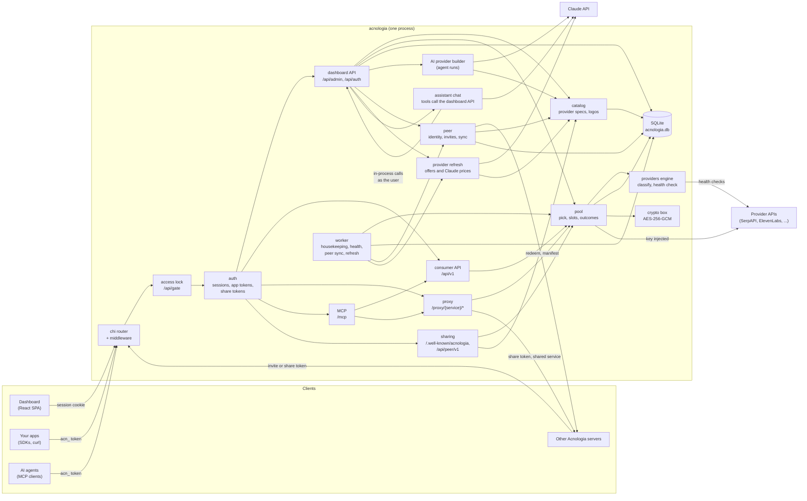
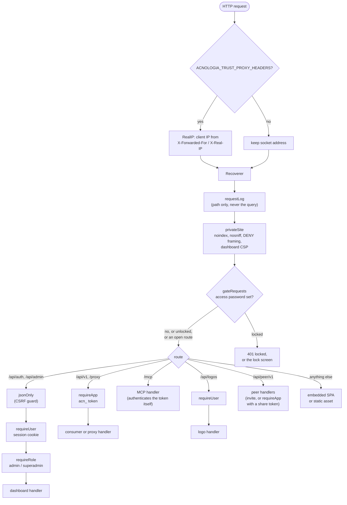
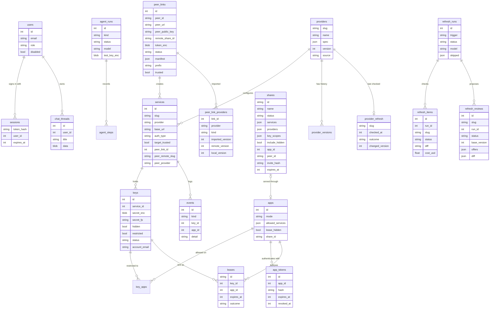
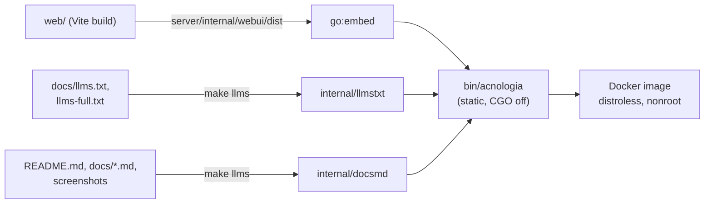
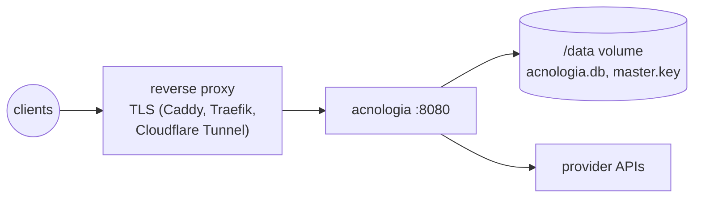

# Server architecture

Acnologia is one Go binary. It serves the React dashboard, the dashboard API, the
consumer API, an HTTP proxy, an MCP endpoint and the server to server sharing
routes from a single process, and keeps everything in one SQLite file. There
is no queue, cache or second service to run.

## Packages

All server code lives under `server/`.

| Package | Responsibility |
|---|---|
| `cmd/acnologia` | Entry point. Loads config, opens the store, verifies the master key, seeds providers, restores lease slots, starts the worker and the HTTP server. Also `acnologia version`, `acnologia gen-master-key`, `acnologia mcp` (a stdio bridge to `/mcp`) and `acnologia ctl`. |
| `internal/config` | Reads `ACNOLOGIA_*` environment variables and an optional `.env` file. See [configuration](configuration.md). |
| `internal/api` | Every HTTP handler: routing and middleware (`server.go`), the access lock (`gate.go`, `solo.go`), sessions, login and admin API tokens (`auth.go`, `tokens_auth.go`), the CLI sign in (`clidevice.go`), dashboard API (`admin.go`, `admin_v2.go`, `providers.go`, `insights.go`, `usage.go`, `app_tokens.go`, `settings.go`), AI routes and model switching (`ai.go`), the provider refresh routes (`refresh.go`), the Assistant chat, its tools, key vault and compaction (`assistant*.go`), sharing between servers (`sharing.go`, `peer_public.go`, `peer_providers.go`), consumer API (`consumer.go`), proxy (`proxy.go`, `proxy_extras.go`), MCP (`mcp.go`, `mcp_v2.go`, `mcp_admin.go`), the control MCP for admin tokens (`mcp_control.go`, its tool table in `mcp_control_tools.go`), the `COGITO_*` era compatibility (`compat.go`) and the Markdown docs (`docs.go`). |
| `internal/pool` | Picks a key for a request, holds per key concurrency slots, applies outcomes (cooldown, exhausted, invalid) and runs health checks. |
| `internal/providers` | The provider spec format and engine: classifying upstream responses into outcomes, running health checks, auth placement, fixture tests, and the built in specs (`builtin*.go`). |
| `internal/catalog` | Provider records on top of the store: validation, publishing with version history, service defaults, live checks, logo discovery and the SSRF safe HTTP client. |
| `internal/agent` | The AI provider builder: a background run that drives Claude with tools to research a provider and produce a spec. Also the shared Claude client used by "Fill with AI", the Assistant and its compaction summaries, and the provider refresh; the model per feature and price overrides (`models.go`, `pricing.go`, `prices.go`); and the offers and Claude price research the refresh calls (`refresh.go`). |
| `internal/store` | SQLite persistence. Schema, migrations and one file per entity. |
| `internal/crypto` | The master key, AES-256-GCM encryption of secrets, keyed fingerprints for duplicate detection, token hashing, secret scrubbing. |
| `internal/redact` | Keeps secrets out of everything that is not the key store: requests to Claude, agent steps, events, the audit log, webhook payloads and log lines. See [security](security.md#what-the-model-can-and-cannot-see). |
| `internal/keyparse` | Pulls keys out of pasted or dropped text: JSON arrays, CSV with a header row, `.env` files and free form lists. |
| `internal/breaker` | The per service circuit breaker that pauses traffic to a provider that keeps failing. |
| `internal/respcache` | The in-memory response cache and idempotent replays, a byte bounded LRU with per entry expiry. |
| `internal/egress` | Routes upstream traffic through HTTP, HTTPS or SOCKS5 proxies, per key or per service. |
| `internal/notify` | Delivers pool events to webhooks: Slack, Discord, Telegram or signed JSON. |
| `internal/peer` | Sharing between servers: the server identity (Ed25519), invites and the signed redeem message, the server to server client, and the receiver's sync that turns a share's manifest into local services and imports the provider specs they need (`providers.go`). The owner side handlers are `internal/api/peer_public.go` and `sharing.go`. See [flows](flows.md#sharing-between-servers). |
| `internal/refresh` | The provider offers refresh: its settings and schedule (`settings.go`, `schedule.go`), runs that re-check each provider's offers and Claude's prices within a budget (`refresher.go`), and the offers diff that decides between publishing and a review (`diff.go`). See [flows](flows.md#keeping-provider-offers-fresh). |
| `internal/worker` | Periodic housekeeping, background health checks, the peer sync loop and the refresh schedule tick. |
| `internal/ctl` | The admin API command line client, built as `acn` (`cmd/acn`) and as `acnologia ctl`. |
| `internal/webui`, `internal/llmstxt`, `internal/docsmd` | Embedded assets: the built dashboard, `llms.txt` and `llms-full.txt`, and the Markdown docs with their images. |

## Request pipeline

Every request passes the same middleware before reaching a handler.

## Data model

Notes:

- **Secrets** are stored only as `secret_enc` (AES-256-GCM, random nonce) plus
  `secret_fp`, a keyed HMAC used to reject duplicates without decrypting.
  Session and app tokens are stored as SHA-256 hashes.
- **Key ids are never reused.** A high water mark in `meta.keys_seq` makes sure
  a new key cannot inherit a deleted key's events, leases or slots.
- **`chat_threads`** holds assistant conversations, one owner each, with the
  transcript encrypted by the same master key as the stored keys.
- **Key account fields** (`account_name`, `account_email`, `account_phone`,
  `account_ref`) record who each key belongs to.
- **`app_tokens`** holds each app's named tokens as SHA-256 hashes; requests,
  spend and limits count per app (`app_usage`) whichever token made the call.
- **Sharing between servers.** `shares` are what this server gives: each is
  backed by a hidden app (`apps.share_id`) whose token the receiver holds, with
  `key_scopes` limiting which keys each shared service may use. `peer_links`
  are what this server received: the share token (encrypted), the last
  manifest and the local services made from it (`services.peer_link_id`,
  `peer_remote_slug`, and `peer_provider`, the owner's provider slug).
  `peer_link_providers` records the provider specs imported through a link and
  their versions on both sides.
- **Provider refresh.** `refresh_runs` and their `refresh_items` record each
  run, `refresh_reviews` the proposals waiting for a superadmin, and
  `provider_refresh` when each provider was last checked and last changed.
- **`agent_runs.model`** keeps the model a builder run was queued with, so a
  model switch never changes a run in flight. **`ai_usage`** is the ledger of
  Claude calls the Usage page prices.
- **`audit`** records every dashboard change and sign in. **`meta`** holds
  small settings such as `master_key_check`, `usage_day`, the server identity
  (`server_identity_key`, encrypted, plus `server_name` and `server_url`), the
  model choice (`ai_models`), price overrides (`ai_prices`) and the refresh
  settings (`provider_refresh`).
- Foreign keys are on, so deleting a service removes its keys and leases, and
  deleting a user removes their sessions.
- The connection pool has one connection, with WAL mode and a 5 second busy
  timeout, which keeps SQLite simple under concurrent requests.

## In memory state

Almost all state is in SQLite. The exception is **concurrency slots**
(`internal/pool/slots.go`): how many requests are in flight on each key, which
leases hold a slot, and a wake channel per service for requests queued on a
busy service. Acnologia runs as a single instance, and on boot it rebuilds lease
slots from open leases in the database (`RestoreLeases`).

## Boot sequence

## Background work

`internal/worker` runs four loops.

| Loop | Interval | Does |
|---|---|---|
| Housekeeping | 30 s | Resets daily usage at UTC midnight, frees slots of expired leases, reactivates exhausted keys whose quota reset time passed, and every 10 minutes prunes expired sessions, leases older than 7 days and events past retention. |
| Peers | 10 min | Reads the manifest of every share another server gave this one, importing the providers of shared services this server lacks, adding new services and disabling removed ones (`internal/peer`). |
| Refresh | 1 min tick | Asks the provider refresh whether a scheduled run is due and starts it in the background (`internal/refresh`). A run checks providers one by one and stops at its budget. |
| Health | 1 min tick | Re-checks keys whose last check is older than `ACNOLOGIA_HEALTH_INTERVAL` (exhausted keys hourly). Skips disabled keys, keys at their concurrency cap, providers without a health check, and hidden keys on services whose target is not trusted. |

Health checks run in their own loop so a slow provider never delays freeing
lease slots.

## Build and packaging

The Dockerfile builds the UI with Node, the binary with Go (`CGO_ENABLED=0`,
pure Go SQLite), and copies the result into a distroless nonroot image with
`ACNOLOGIA_DATA_DIR=/data`. The image declares no volume: Compose and hosts
such as Railway mount their own at `/data`. On Windows, `scripts/build.ps1`
does the same build without make (see [development](development.md#windows)).

## Deployment shape

One instance per data directory. Put it behind TLS, set
`ACNOLOGIA_SECURE_COOKIES=true` and `ACNOLOGIA_TRUST_PROXY_HEADERS=true`, and keep the
master key out of the data volume (set `ACNOLOGIA_MASTER_KEY` from a secret store)
so a copy of the volume alone does not reveal stored keys.

See also: [request flows](flows.md), [security model](security.md),
[provider specs](providers.md).
