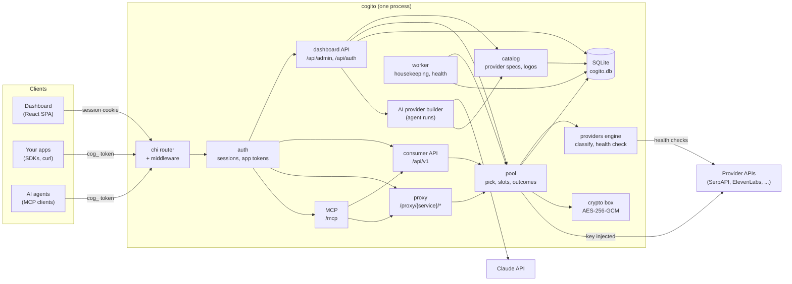
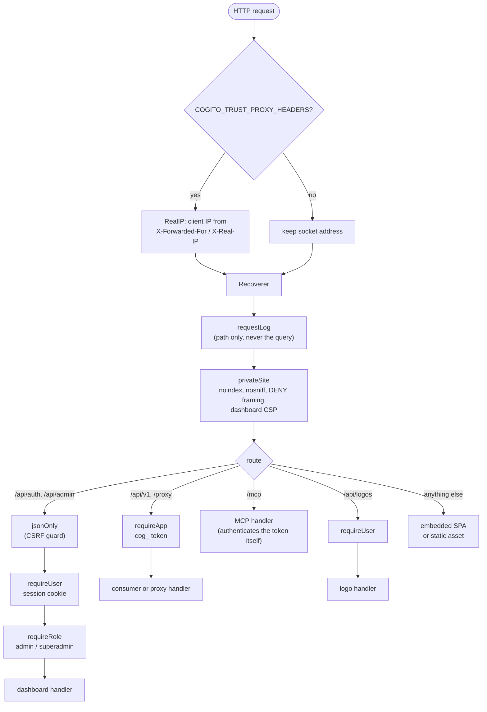
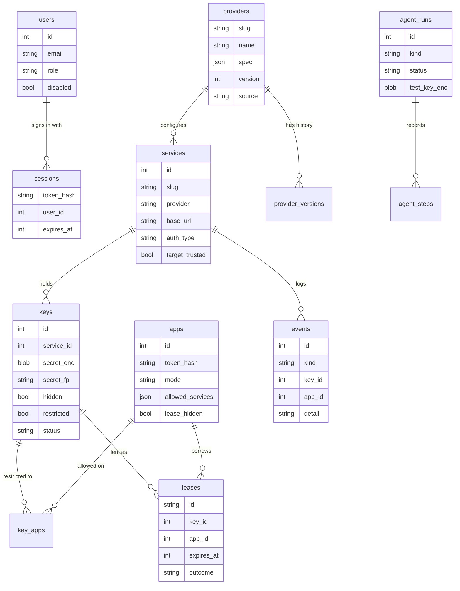
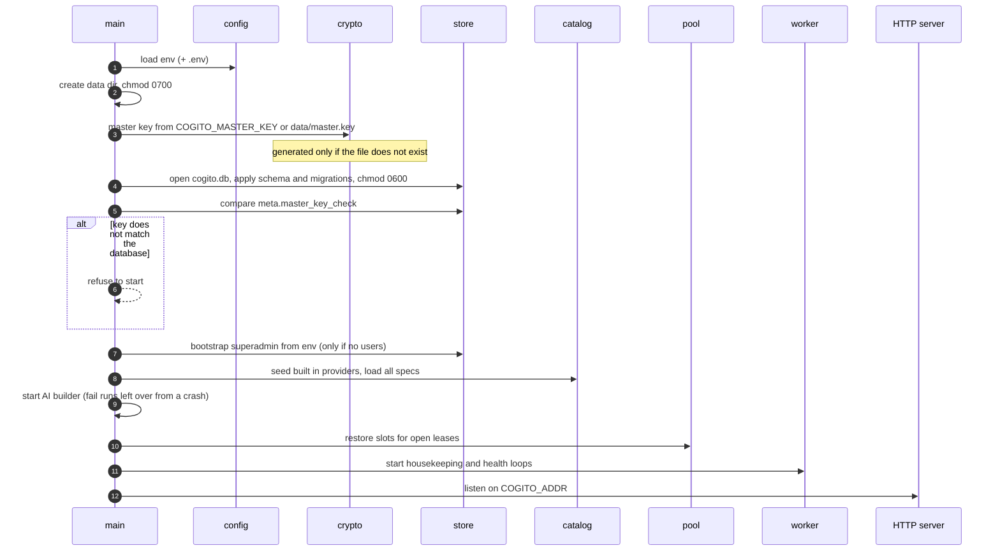
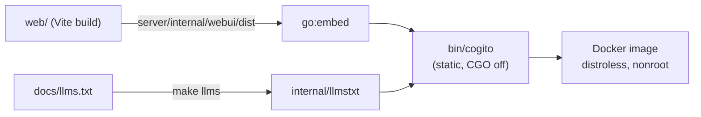
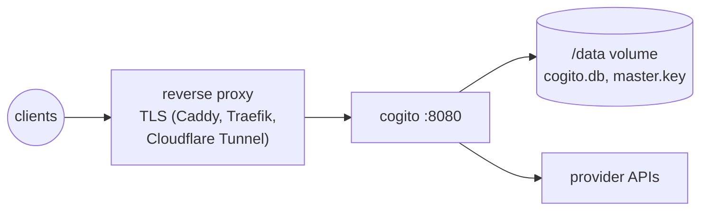

# Server architecture

Cogito is one Go binary. It serves the React dashboard, the dashboard API, the
consumer API, an HTTP proxy and an MCP endpoint from a single process, and
keeps everything in one SQLite file. There is no queue, cache or second
service to run.

## Packages

All server code lives under `server/`.

| Package | Responsibility |
|---|---|
| `cmd/cogito` | Entry point. Loads config, opens the store, verifies the master key, seeds providers, restores lease slots, starts the worker and the HTTP server. Also `cogito version` and `cogito gen-master-key`. |
| `internal/config` | Reads `COGITO_*` environment variables and an optional `.env` file. See [configuration](configuration.md). |
| `internal/api` | Every HTTP handler: routing and middleware (`server.go`), sessions and login (`auth.go`), dashboard API (`admin.go`, `providers.go`, `insights.go`, `ai.go`), consumer API (`consumer.go`), proxy (`proxy.go`) and MCP (`mcp.go`). |
| `internal/pool` | Picks a key for a request, holds per key concurrency slots, applies outcomes (cooldown, exhausted, invalid) and runs health checks. |
| `internal/providers` | The provider spec format and engine: classifying upstream responses into outcomes, running health checks, auth placement, fixture tests, and the built in SerpAPI, ElevenLabs and generic specs. |
| `internal/catalog` | Provider records on top of the store: validation, publishing with version history, service defaults, live checks, logo discovery and the SSRF safe HTTP client. |
| `internal/agent` | The AI provider builder: a background run that drives Claude with tools to research a provider and produce a spec. |
| `internal/store` | SQLite persistence. Schema, migrations and one file per entity. |
| `internal/crypto` | The master key, AES-256-GCM encryption of secrets, keyed fingerprints for duplicate detection, token hashing, secret scrubbing. |
| `internal/worker` | Periodic housekeeping and background health checks. |
| `internal/webui`, `internal/llmstxt` | Embedded assets: the built dashboard and `llms.txt`. |

## Request pipeline

Every request passes the same middleware before reaching a handler.

## Data model

Notes:

- **Secrets** are stored only as `secret_enc` (AES-256-GCM, random nonce) plus
  `secret_fp`, a keyed HMAC used to reject duplicates without decrypting.
  Session and app tokens are stored as SHA-256 hashes.
- **Key ids are never reused.** A high water mark in `meta.keys_seq` makes sure
  a new key cannot inherit a deleted key's events, leases or slots.
- **`audit`** records every dashboard change and sign in. **`meta`** holds
  small settings such as `master_key_check` and `usage_day`.
- Foreign keys are on, so deleting a service removes its keys and leases, and
  deleting a user removes their sessions.
- The connection pool has one connection, with WAL mode and a 5 second busy
  timeout, which keeps SQLite simple under concurrent requests.

## In memory state

Almost all state is in SQLite. The exception is **concurrency slots**
(`internal/pool/slots.go`): how many requests are in flight on each key, which
leases hold a slot, and a wake channel per service for requests queued on a
busy service. Cogito runs as a single instance, and on boot it rebuilds lease
slots from open leases in the database (`RestoreLeases`).

## Boot sequence

## Background work

`internal/worker` runs two loops.

| Loop | Interval | Does |
|---|---|---|
| Housekeeping | 30 s | Resets daily usage at UTC midnight, frees slots of expired leases, reactivates exhausted keys whose quota reset time passed, and every 10 minutes prunes expired sessions, leases older than 7 days and events past retention. |
| Health | 1 min tick | Re-checks keys whose last check is older than `COGITO_HEALTH_INTERVAL` (exhausted keys hourly). Skips disabled keys, keys at their concurrency cap, providers without a health check, and hidden keys on services whose target is not trusted. |

Health checks run in their own loop so a slow provider never delays freeing
lease slots.

## Build and packaging

The Dockerfile builds the UI with Node, the binary with Go (`CGO_ENABLED=0`,
pure Go SQLite), and copies the result into a distroless nonroot image with a
`/data` volume.

## Deployment shape

One instance per data directory. Put it behind TLS, set
`COGITO_SECURE_COOKIES=true` and `COGITO_TRUST_PROXY_HEADERS=true`, and keep the
master key out of the data volume (set `COGITO_MASTER_KEY` from a secret store)
so a copy of the volume alone does not reveal stored keys.

See also: [request flows](flows.md), [security model](security.md),
[provider specs](providers.md).
