# Request flows

How the main paths through the server work, step by step. Diagrams use
Mermaid and render on GitHub.

- [Proxy request](#proxy-request)
- [Picking a key](#picking-a-key)
- [Lease and report](#lease-and-report)
- [Key states](#key-states)
- [Classifying an upstream response](#classifying-an-upstream-response)
- [Health checks](#health-checks)
- [Dashboard sign in](#dashboard-sign-in)
- [MCP](#mcp)
- [AI provider builder](#ai-provider-builder)
- [Assistant chat](#assistant-chat)
- [Sharing between servers](#sharing-between-servers)

## Proxy request

`ANY /proxy/{service}/{path}`. The app never sees the key. Acnologia retries with
the next key when a response says the key itself is the problem.

Details worth knowing:

- The upstream URL is built from the parsed `base_url`, so an encoded `?` or
  `#` in the path stays in the path. Literal dot segments (`.`, `..`) are
  refused with 400 `bad_path`.
- `TRACE` and `CONNECT` are refused with 405.
- Redirects are passed back to the app, never followed with the key, and any
  copy of the key in a response header (for example a `Location` that kept the
  query string) is replaced with `[key]`.
- A 5xx is not retried on another key, so a non-idempotent request is never
  sent twice after the provider may have acted on it.
- If the network fails on a later attempt, the earlier provider answer is
  relayed instead of a bare 502.

## Picking a key

`internal/pool/pool.go` `Pick`, run under a per service lock.

## Lease and report

`POST /api/v1/lease` hands the plaintext key to the app; the app calls the
provider itself and reports what happened.

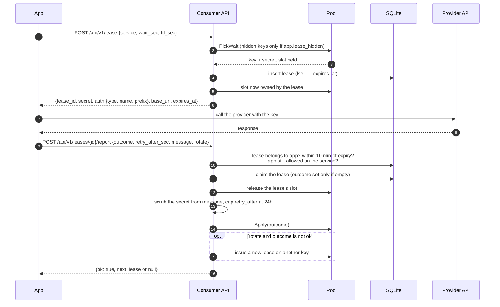

Unreported leases keep their slot until `expires_at`, when the worker frees it.
A report later than 10 minutes after expiry gets 410; a second report gets 409.

## Key states

`status` is stored; `cooling` is derived from `cooldown_until`.

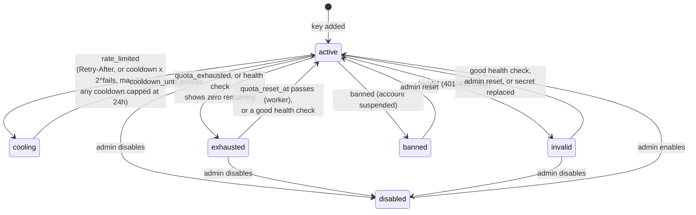

Each provider's rules sort an error response into an outcome, and each outcome
has its own recovery:

| Outcome | Typical cause | What happens to the key |
|---|---|---|
| `rate_limited` | 429, an hourly cap, `Retry-After` | Rests for as long as the provider asked, or the service cooldown doubled per consecutive failure up to an hour. The next key takes the request. |
| `busy` | the account is at its concurrency cap | Steps aside for about a second, without backoff or a failure count. |
| `quota_exhausted` | out of searches, characters or credits | Parked as `exhausted` until its quota resets (or 24 hours), then back on its own. |
| `invalid` | the provider rejects the key | Out of rotation until a health check passes. |
| `banned` | the provider suspended the account | Out until an admin resets it. Health checks skip it. |
| `error` | 5xx, timeouts, refused connections | Not penalized. Errors count toward the service's circuit breaker: 10 in 60 seconds open it, requests then get 503 `service_unavailable` at once, and one probe goes through every 30 seconds until the provider recovers. |

An `error` outcome (5xx, network) records the error but does not change state.
Separately, each key reports **validity**: `invalid`, `valid` (it worked at
`last_ok_at`) or `unknown`.

## Classifying an upstream response

`internal/providers/engine.go` `Classify`. Provider rules come from the spec;
see [provider specs](providers.md).

## Health checks

Run by the worker on an interval, after adding keys, or on demand from the
dashboard (one key, one service, or all keys).

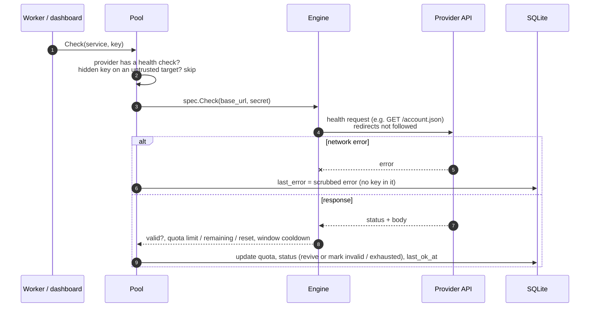

## Dashboard sign in

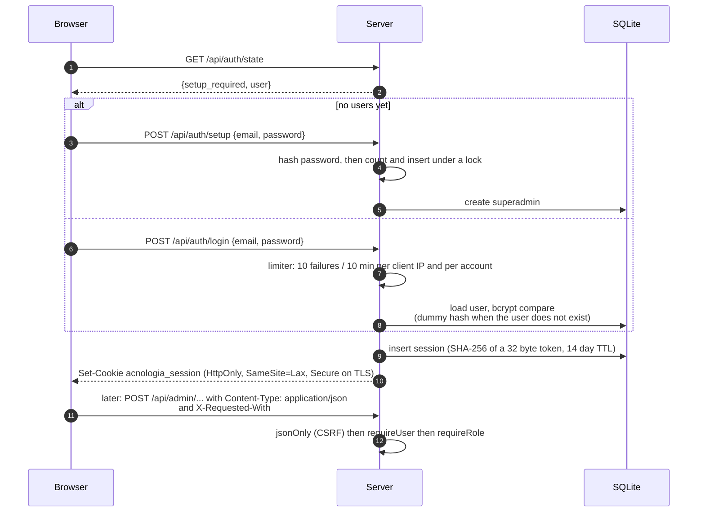

Sessions end on logout, after 14 days, when the user is disabled, when their
password is changed (other sessions) or reset by a superadmin (all sessions).

## MCP

`POST /mcp` speaks JSON-RPC over the MCP streamable HTTP transport with JSON
responses. Tools map onto the consumer API and the proxy, with the same app
token rules. Each app picks its tool sets in the dashboard (`GET`/`PUT
/api/admin/apps/{id}/mcp`): **core** (`list_services`, `pool_status`,
`get_key`, `renew_key`, `report_key`, `proxy_request`), **service tools**
generated from each provider's examples, read only **insights**
(`list_keys`, `key_details`, `service_stats`) and **manage** (`check_keys`,
`set_key_status`, `add_keys`). Core, service tools, resources and prompts are
on by default. Clients that only speak stdio can use `acnologia mcp --url ...
--token acn_...` as a bridge.

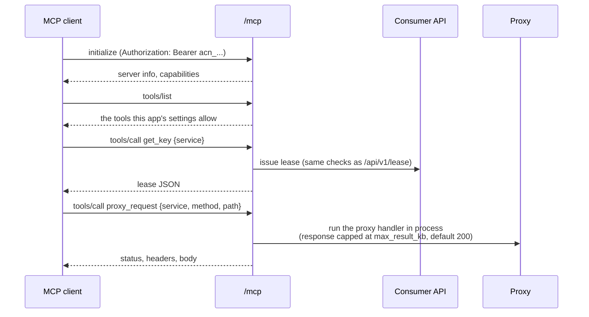

## AI provider builder

An admin starts a run with context, URLs and optionally a test key. The run
uses Claude with tools and ends in a published spec, a draft for review, or a
failure. Requires `ANTHROPIC_API_KEY`.

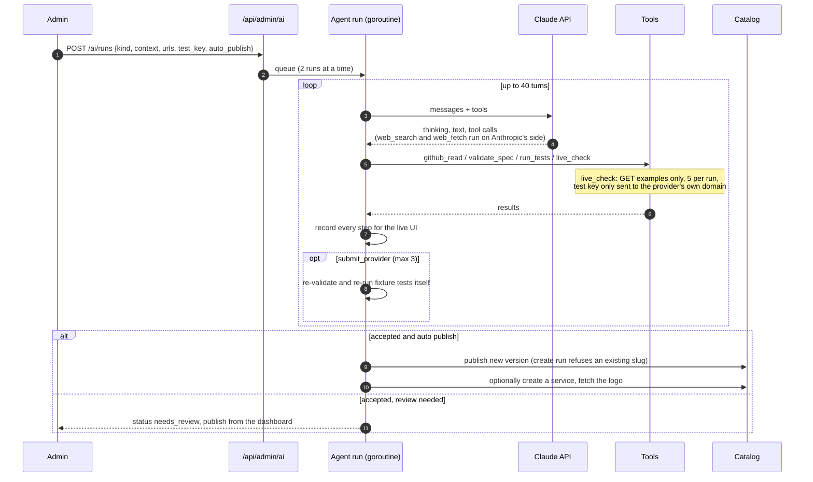

Run states:

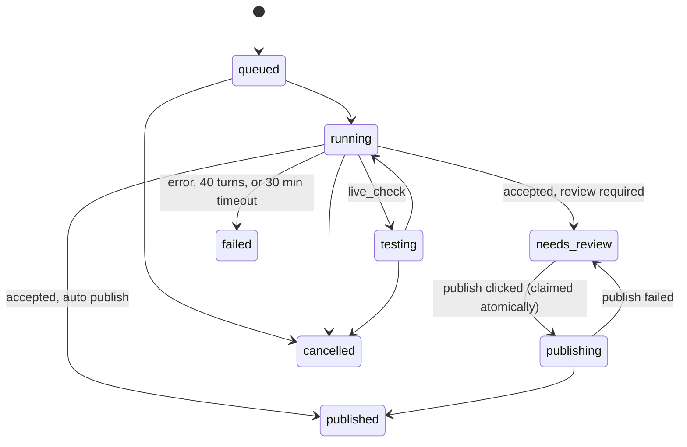

Auto publish defaults to on for new providers and off for updates of existing
ones. The test key is encrypted while the run is active and wiped when it ends.
Every request to Claude passes the redactor first, so the model sees the test
key only as a placeholder such as `[key ...c21e]` (see
[security](security.md#what-the-model-can-and-cannot-see)).

Finished runs can be deleted by an admin: `DELETE /api/admin/ai/runs/{id}`
for one run (409 `run_busy` while it is queued, running, testing or
publishing), or `DELETE /api/admin/ai/runs` to clear every failed, cancelled
and published run. Runs waiting for review are kept by the bulk clear.

## Keeping provider offers fresh

Offers (free tiers, prices, published rate limits) feed the pacer, cost
accounting and every place that shows what is free. Prices change, so a
superadmin can have Acnologia re-read them. Settings, Provider refresh holds
the controls, the history and the changes waiting for review. It needs
`ANTHROPIC_API_KEY`; with AI off nothing runs.

**When.** A run starts in one of three ways:

- On the schedule: off, weekly, every 2 weeks, monthly (on the 1st) or every
  N days (1–365), at a chosen UTC hour. The worker asks once a minute whether
  a run is due. The first run is the first time the clock reaches the hour
  after the schedule was saved; weekly and every N days count from the day of
  the last scheduled run; monthly runs on the 1st of the next month. A run
  missed while the server was off starts as soon as it is back.
- Run refresh now in Settings (superadmin): the whole scope, same rules.
- Check now on the service page's Offers and limits card or the provider's
  Offers tab (superadmin): one provider, whatever the scope and staleness say.

**Which providers.** The scope is providers behind at least one service with
a usable key (active, cooling or out of quota; the default), providers behind
any service, or every provider. Always check adds providers whatever the
scope; Never check removes them and wins. Providers copied from another
server (source `peer:...`) are skipped unless you turn them on: their owner
keeps them current and your copy follows theirs. Disabled providers are
skipped unless listed under Always check. A provider whose offers were read
within the last N days (default 25, from its last refresh check or the
newest `checked_at` on its offers) is skipped. The rest go oldest checked
first, at most N per run (default 10).

**How one provider is checked.** The refresh model (the refresh slot in
Settings, Models; a small model such as Haiku is enough) gets the provider's
name, base URL, website, docs URL, the `source_url` of each offer, its
example names and its current offers. Keys never leave the server, and every
request passes the same redaction as the rest of the AI features. It may run
3 web searches and 5 page fetches within 8 turns, then must call
`submit_offers` with the full list and `verified`. The offers are validated
like any spec edit (a failure goes back to the model once). Each call is
recorded in the AI usage ledger under the `refresh` feature with the run as
its ref.

**What happens next.** The proposed offers are compared with the current
ones by name, ignoring `checked_at`:

- No change: `checked_at` moves to today on the current version, in place,
  with no new version (so a built in provider stays unedited and keeps
  getting the offers new releases ship).
- A change, with apply set to Apply sourced changes (the default): if every
  added or changed offer cites an http(s) `source_url` and the change does
  not remove every offer, a new provider version is published with source
  `refresh` and a note listing what changed. Only `offers` changes: never
  auth, the base URL, rules, health checks or tests. A webhook
  `provider.offers_changed` fires and the audit log records it. A built in
  provider changed this way becomes an edited version, like any edit, so
  later releases no longer backfill its offers. Roll back from the provider's
  Versions tab.
- Otherwise (no source, removing every offer, apply set to Always review, or
  the publish failed) the change waits in Settings under Waiting for review
  with a readable diff. Apply publishes it as above; Dismiss drops it. A
  proposal made against a version that has since changed cannot be applied:
  dismiss it and check again. A newer proposal for the same provider replaces
  an older pending one.
- The model could not read the pages, the call failed, or the offers did not
  validate: the item fails, nothing changes, and the provider is not counted
  as checked, so the next run tries again. One provider failing never stops
  the others.

**Claude's own prices.** With Claude model prices on (the default), every run
also re-reads Anthropic's pricing page for the models Acnologia prices and
proposes new input, output and cache prices. The same rule applies: a change
saves as price overrides on its own only when every changed price cites its
page, else it waits for review. The model picker shows each price's source
and the date it was checked. Superadmins can also edit a model's price and
context window by hand in Settings, Models, Model prices, and reset it to the
built in table.

**Budget and safety.** Before each provider, a run stops if it has spent its
per run cap (default $2) or the refresh feature has spent its monthly cap
(default $5) since the 1st, UTC; a check that crosses the cap mid way stops
there. Providers it did not reach are marked Not reached. Only one run goes
at a time: Run now and Check now answer 409 while one is running. A run's
state lives in the database, so a restart resumes it on the next tick, with
the provider that was being checked starting over.

**Where to see it.** The service page's Offers and limits card says when the
offers were checked and by what (scheduled refresh, a refresh by hand, Check
now, or when the provider was written), when a refresh last changed them
with a link to that version, and whether a change waits for review. Settings,
Provider refresh shows the model, the last and next run, the month's spend
against its cap, recent runs with each provider's outcome and cost, and the
reviews. Settings changes, runs started by hand, applies and dismissals are
audited (`provider.refresh.*`, `ai.prices`).

## Assistant chat

The Assistant page is a chat where Claude manages Acnologia for you. Every action
is a tool call that the server turns into a request to its own dashboard API,
**made as you** (your session), so it gets exactly your role, the same
validation, and the same audit log entries as clicking in the UI.

Typical "add keys" path the assistant follows:

Confirmations:

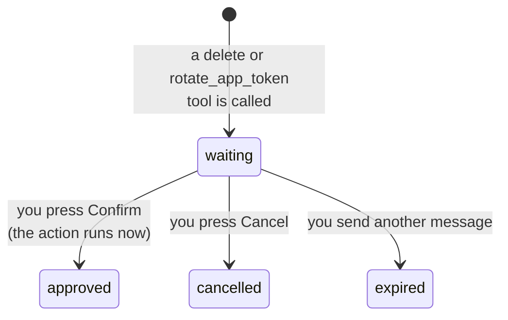

Tools by role:

| Role | Tools |
|---|---|
| member and up | ask_user, search_providers, provider_offers, wait_for_build, overview, list_providers, get_provider, list_services, list_keys, key_details, list_apps, app_usage, list_events, list_webhooks, list_egress_proxies, list_groups, service_breaker, cache_stats, app_mcp_settings, get_ai_run |
| admin and up | create_service, update_service, add_keys, update_key, check_keys, reset_key, create_app, update_app (including limits), create_webhook, update_webhook, test_webhook, create_egress_proxy, update_egress_proxy, test_egress_proxy, create_group, update_group, reset_breaker, purge_cache, update_app_mcp, start_provider_build |
| admin and up, after Confirm | delete_key, delete_service, delete_app, rotate_app_token, delete_webhook, delete_egress_proxy, delete_group, enable_app_mcp_manage |

`ask_user` shows a small form in the chat (name the pasted keys, or pick one
of 2 to 8 choices); the answer goes to `POST /threads/{id}/answer`.

There is no tool to reveal a stored key, manage users or read the audit log.
New app tokens and webhook signing secrets are shown to you once and never
sent to Claude; egress proxy URLs are redacted from the stored chat like keys.

In the dashboard, a message with pasted keys shows its prose first and a
"keys secured" strip of chips (label and last four characters, never a
secret). The chat state lives in the page's store: the last open chat comes
back when you return from another tab, unsent drafts are kept per chat while
the page is open, and a turn still running is picked up again.

### Compaction

A long chat would eventually overflow the model's context window and gets
slower and dearer on every turn. Before each model call the server estimates
the prompt: the input tokens Claude reported for the last call plus about one
token per four characters added since, or a character estimate of the whole
prompt, whichever is larger. Past 60% of the context window of the
Assistant's model (or `ACNOLOGIA_CHAT_COMPACT_TOKENS`), it compacts. The
summary runs on the chat summaries model from Settings, AI, which can be a
smaller, cheaper one than the Assistant's:

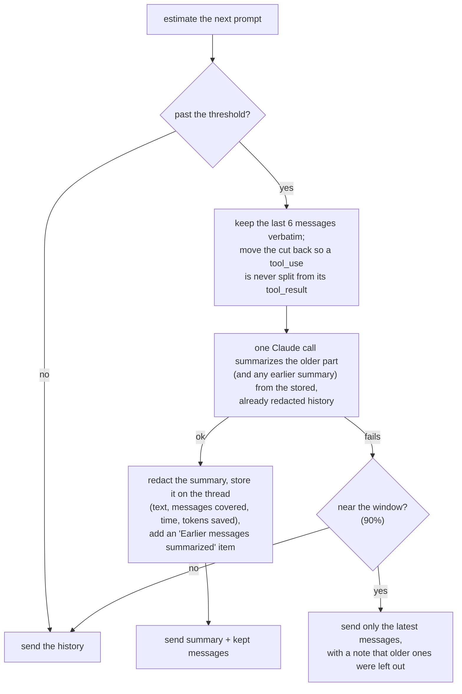

- Nothing is deleted. The stored messages and the transcript stay whole, so you
  still see every message above the divider; only what Claude is sent changes.
- Repeated compaction folds the previous summary into the new one.
- The summary keeps goals, decisions, the names and ids of services, keys, apps
  and providers touched, pending tasks and open questions. Key placeholders stay
  as they are; the summary passes the same redactor as tool results, so it never
  holds a secret.
- The summary call is billed as Assistant usage on the Usage page.
- A failed summary is logged and not retried in that turn; the chat carries on.
- The thread's menu (the dots at the top right of the chat) has **Compact now**,
  which calls `POST /chat/threads/{id}/compact` whatever the chat's size. Open
  the divider to read the summary.

## Sharing between servers

One Acnologia (the **owner**) can let another (the **receiver**) use some of
its services and give it provider specs. Keys never leave the owner: the
receiver calls the owner's proxy with a share token, and the owner picks and
injects its own key. Pairing is by invite only.

Every server has an identity: an Ed25519 keypair made on first start (the
private key encrypted with the master key, in `meta`), an id `acn_srv_` plus
20 characters derived from the public key, a name (the hostname until a
superadmin renames it) and a public URL (`ACNOLOGIA_PUBLIC_URL`, else the one
saved on the Sharing page, else the request origin). It is published at
`/.well-known/acnologia`.

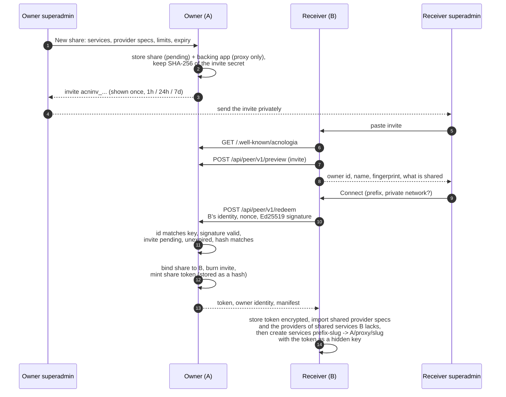

**Using a shared service.** A local app on B calls `/proxy/a-serpapi/...` like
any other service. B injects the share token as a bearer token and adds
`X-Acnologia-Hop: n+1`; A authenticates the token, checks the share is active
and unexpired, applies its limits and proxies with its own keys. The service's
provider is `acnologia-peer`, whose rules count only A's own refusals against
the token: 403 `share_revoked` or `share_paused` and 401 mark it invalid, 429
`app_limit_reached` makes it exhausted until the reset, 503 `no_key_available`,
`all_keys_busy` or `service_unavailable` cool it for `retry_after_sec`, and
anything A relays from the upstream is passed on untouched (A already rotated).
Shared services are proxy only: a lease would hand out the token.

**Which keys.** Each shared service can be limited to all its keys, up to N
keys, or a picked list (`key_scopes`, see [the API](api.md#sharing-between-servers)).
A's pool applies the scope on every pick for the share's backing app, using a
per app cache that any share change clears, so ordinary apps pay nothing. Up
to N takes the first N keys still in rotation by priority; when one turns
invalid, banned or disabled the next one takes its place, while a key that is
only cooling down or out of quota keeps its slot. The Sharing page shows each
service as `serpapi · 3 of 10 keys` and each set limit as a meter of what was
used today or this month against its cap.

**Sync.** B reads each link's manifest every 10 minutes and on Sync now. New
services are created; services no longer shared keep their row (events and app
settings survive) but their key is disabled; a status change applies at once.
Providers are synced before services, so a new service already has its
provider when it is made.

**Providers of shared services.** The manifest carries the spec of every
provider a shared service uses (`shared: false`) next to the ones shared on
purpose (`shared: true`). When B has no provider with that slug, sync imports
it too, as a dependency of the services that need it, so the service keeps
the provider's name, logo, color, category, docs and website links, Integrate
examples, offers and MCP tools. The local service keeps provider
`acnologia-peer`, which classifies the share token's answers and carries the
token, and records the owner's provider slug in `peer_provider`, which the
dashboard, the Integrate tab, Copy for LLM, the catalog and MCP use to
describe it (with a "via <server>" marker). When B already has a provider
with that slug, B's own spec describes the service and is never touched.

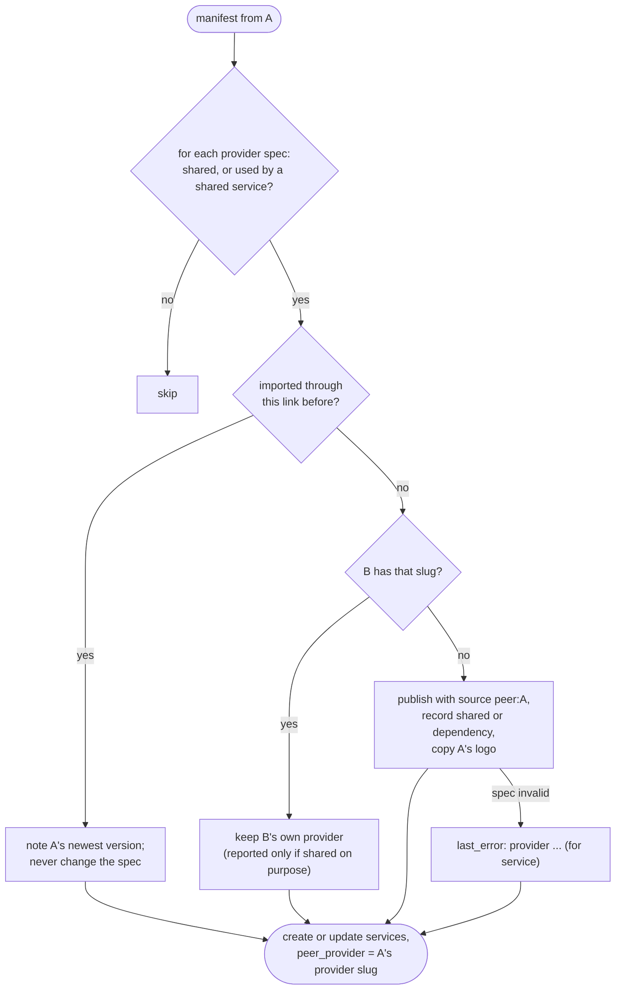

Each import is done once with source `peer:<owner id>`. Later edits on the
owner are never applied on their own, so an owner cannot redirect keys B adds
to an imported provider. When A's version is newer than the one imported, the
service page says so, and a superadmin can pull it (`POST
/api/admin/peers/{id}/providers/{slug}/pull`); when the new spec moves the base
URL, the pull needs an explicit yes. A provider edited on B since the import
is not offered updates. If the import fails (an invalid spec, for example),
the service is still created and works through the proxy, and the reason is
in the link's `last_error`; the next sync tries again. Re-syncing an
unchanged manifest changes nothing.

**Logos.** After importing a provider that has no logo, B asks A for it
(`GET /api/peer/v1/providers/{slug}/logo` with the share token, sent only to
A's URL). A serves logos only for providers in that share's manifest. B
accepts an allowed image type no larger than 512 KB whose bytes match the
declared type, stores it like any provider logo and retries at each sync
while the provider has none. When A has no logo, B tries the catalog's logo
discovery on the provider's website once (public addresses only, no token).

**Offers.** A peer service shows the owner provider's offers for reference,
but they do not pace the share token or price its requests: B's one key is
the token, which stands for all of A's keys, and A already paces its own keys
under those limits and enforces the share's request and budget caps.

**Revoke, pause, expire.** Revoking deactivates the backing app and revokes
its token in the same transaction, so the very next request through A gets
403 `share_revoked` with `X-Acnologia-Share: revoked`. B marks the link
revoked as soon as it sees that answer (from the proxy or the manifest),
deletes the token and the services' key, and the services stop. Pause is the
same with `share_paused` and can be undone; B turns its services back on at
the next sync after a resume. Expiry is checked on every request.

**Disconnect.** B tells A (`POST /api/peer/v1/leave`, best effort), deletes the
token and the keys holding it and leaves the services in place without a key.
A shows the share as left by the peer. Providers imported from A stay on B
after a disconnect or revoke, whether or not B added keys to them: they are
plain specs with no secret, B's own services may use them, and a superadmin
can delete one B does not use from the Providers page.

**Loops.** A service whose provider is `acnologia-peer` can never be shared
onward, and a request that already passed through more than 3 servers gets 508
`loop_detected`.
