# Request flows

How the main paths through the server work, step by step. Diagrams use
Mermaid and render on GitHub.

- [Proxy request](#proxy-request)
- [Picking a key](#picking-a-key)
- [Lease and report](#lease-and-report)
- [Key states](#key-states)
- [Classifying an upstream response](#classifying-an-upstream-response)
- [Health checks](#health-checks)
- [Dashboard sign in](#dashboard-sign-in)
- [MCP](#mcp)
- [AI provider builder](#ai-provider-builder)
- [Assistant chat](#assistant-chat)

## Proxy request

`ANY /proxy/{service}/{path}`. The app never sees the key. Acnologia retries with
the next key when a response says the key itself is the problem.

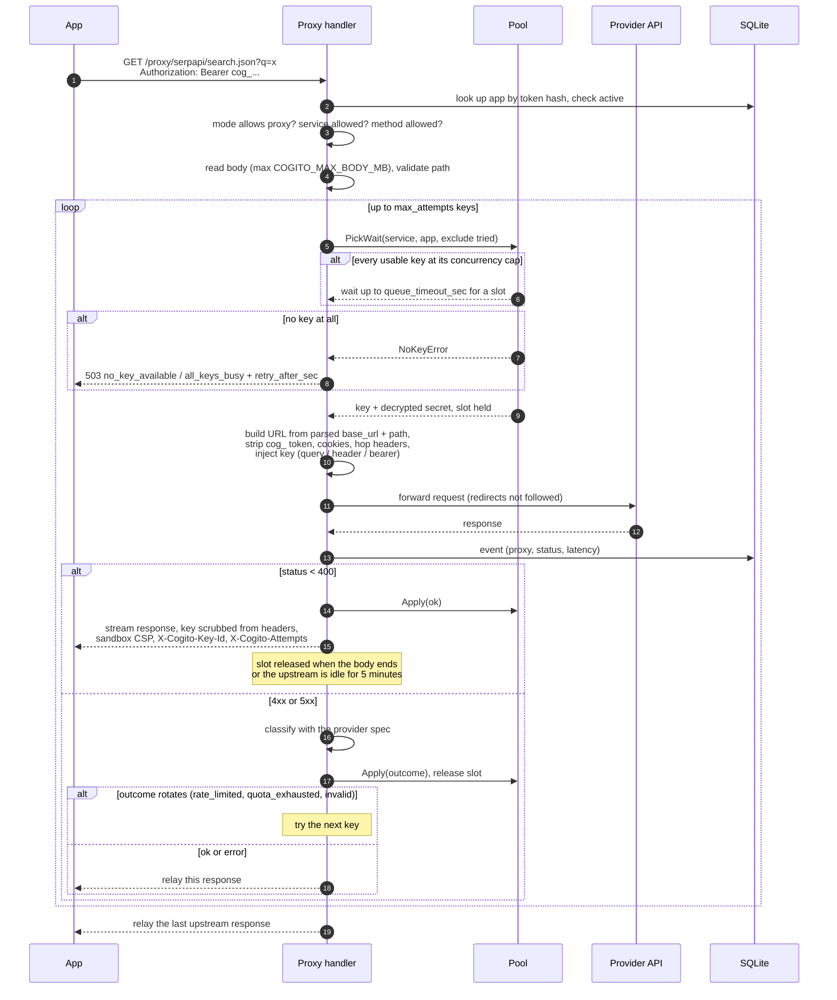

Details worth knowing:

- The upstream URL is built from the parsed `base_url`, so an encoded `?` or
  `#` in the path stays in the path. Literal dot segments (`.`, `..`) are
  refused with 400 `bad_path`.
- `TRACE` and `CONNECT` are refused with 405.
- Redirects are passed back to the app, never followed with the key, and any
  copy of the key in a response header (for example a `Location` that kept the
  query string) is replaced with `[key]`.
- A 5xx is not retried on another key, so a non-idempotent request is never
  sent twice after the provider may have acted on it.
- If the network fails on a later attempt, the earlier provider answer is
  relayed instead of a bare 502.

## Picking a key

`internal/pool/pool.go` `Pick`, run under a per service lock.

```mermaid
flowchart TD
    Start([Pick for app on service]) --> Load["load keys with status active"]
    Load --> Each{for each key}
    Each --> Ex{"excluded, or restricted<br/>and app not listed?"}
    Ex -->|yes| Each
    Ex -->|no| Hid{"hidden key?"}
    Hid -->|"yes, and the app lacks lease_hidden<br/>or the service target is untrusted"| Each
    Hid -->|no or allowed| Avail{"cooling down or<br/>quota at zero?"}
    Avail -->|yes| Note1["remember earliest cooldown end"] --> Each
    Avail -->|no| Cap{"in-flight count at the<br/>key's concurrency limit?"}
    Cap -->|yes| Busy["busy = true"] --> Each
    Cap -->|no| Tier{"tier"}
    Tier -->|primary| Prim[primary set]
    Tier -->|backup| Back[backup set]
    Prim --> Each
    Back --> Each
    Each -->|done| Set{"primary set empty?"}
    Set -->|no| Choose
    Set -->|yes, backup has keys| Choose
    Set -->|both empty| NoKey["NoKeyError<br/>(Busy, RetryAfter)"]
    Choose["choose by strategy:<br/>round_robin, fill_first, least_used,<br/>most_quota, random (weighted)"] --> Dec["decrypt secret, mark used,<br/>acquire slot"]
    Dec --> Done([Picked])
```

## Lease and report

`POST /api/v1/lease` hands the plaintext key to the app; the app calls the
provider itself and reports what happened.

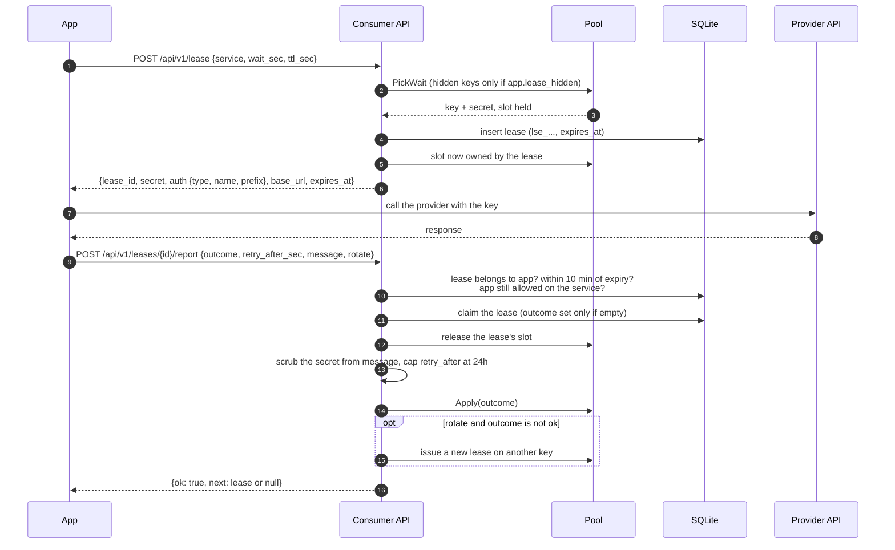

Unreported leases keep their slot until `expires_at`, when the worker frees it.
A report later than 10 minutes after expiry gets 410; a second report gets 409.

## Key states

`status` is stored; `cooling` is derived from `cooldown_until`.

```mermaid
stateDiagram-v2
    [*] --> active: key added
    active --> cooling: rate_limited<br/>(Retry-After, or cooldown x 2^fails, max 1h;<br/>any cooldown capped at 24h)
    cooling --> active: cooldown_until passes
    active --> exhausted: quota_exhausted, or health check<br/>shows zero remaining
    exhausted --> active: quota_reset_at passes (worker),<br/>or a good health check
    active --> invalid: invalid (401/403 class)
    invalid --> active: good health check,<br/>admin reset, or secret replaced
    active --> disabled: admin disables
    disabled --> active: admin enables
    exhausted --> disabled: admin disables
    invalid --> disabled: admin disables
```

An `error` outcome (5xx, network) records the error but does not change state.
Separately, each key reports **validity**: `invalid`, `valid` (it worked at
`last_ok_at`) or `unknown`.

## Classifying an upstream response

`internal/providers/engine.go` `Classify`. Provider rules come from the spec;
see [provider specs](providers.md).

## Health checks

Run by the worker on an interval, after adding keys, or on demand from the
dashboard (one key, one service, or all keys).

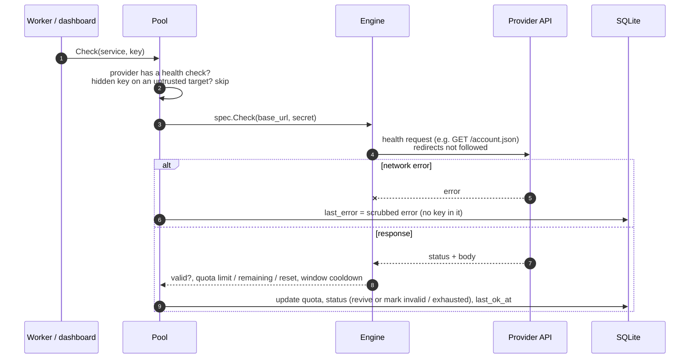

## Dashboard sign in

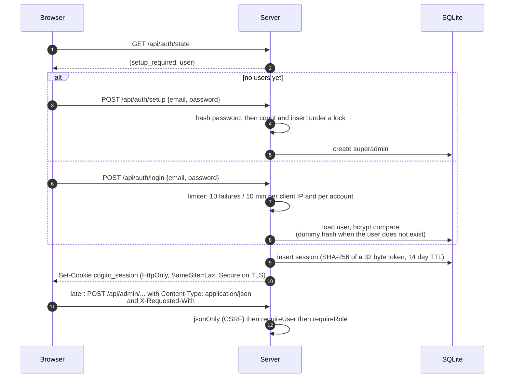

Sessions end on logout, after 14 days, when the user is disabled, when their
password is changed (other sessions) or reset by a superadmin (all sessions).

## MCP

`POST /mcp` speaks JSON-RPC over the MCP streamable HTTP transport with JSON
responses. Tools map onto the consumer API and the proxy, with the same app
token rules.

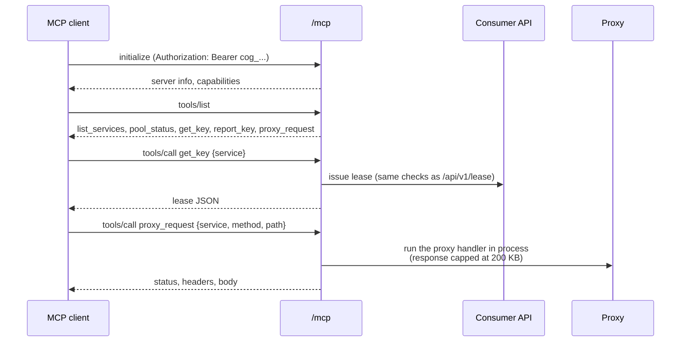

## AI provider builder

An admin starts a run with context, URLs and optionally a test key. The run
uses Claude with tools and ends in a published spec, a draft for review, or a
failure. Requires `ANTHROPIC_API_KEY`.

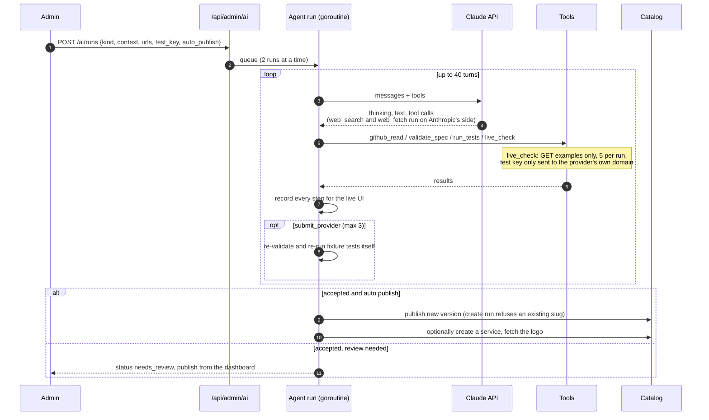

Run states:

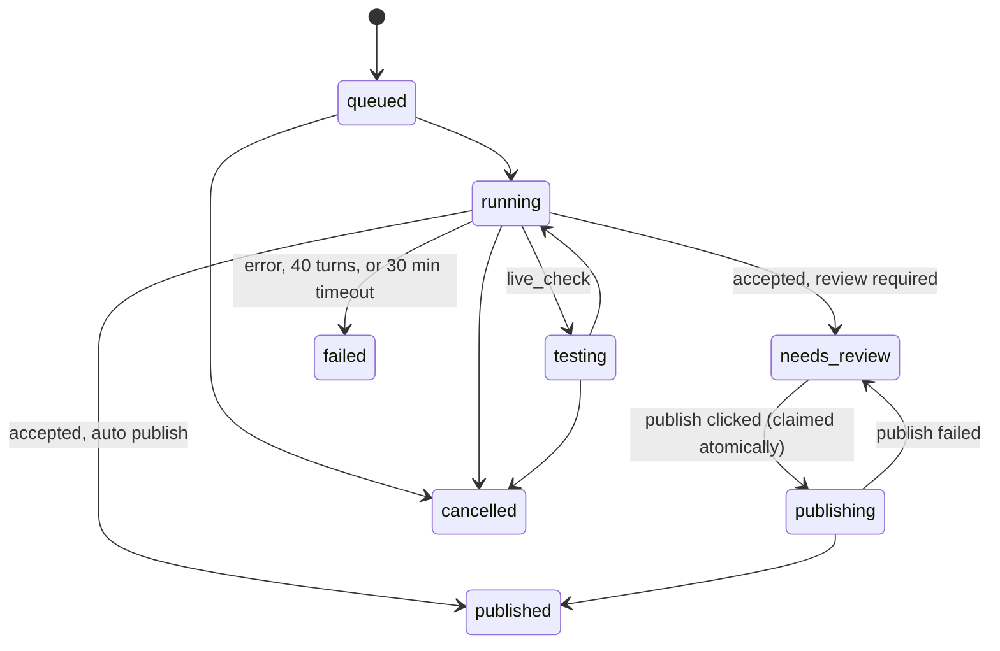

Auto publish defaults to on for new providers and off for updates of existing
ones. The test key is encrypted while the run is active and wiped when it ends.

## Assistant chat

The Assistant page is a chat where Claude manages Acnologia for you. Every action
is a tool call that the server turns into a request to its own dashboard API,
**made as you** (your session), so it gets exactly your role, the same
validation, and the same audit log entries as clicking in the UI.

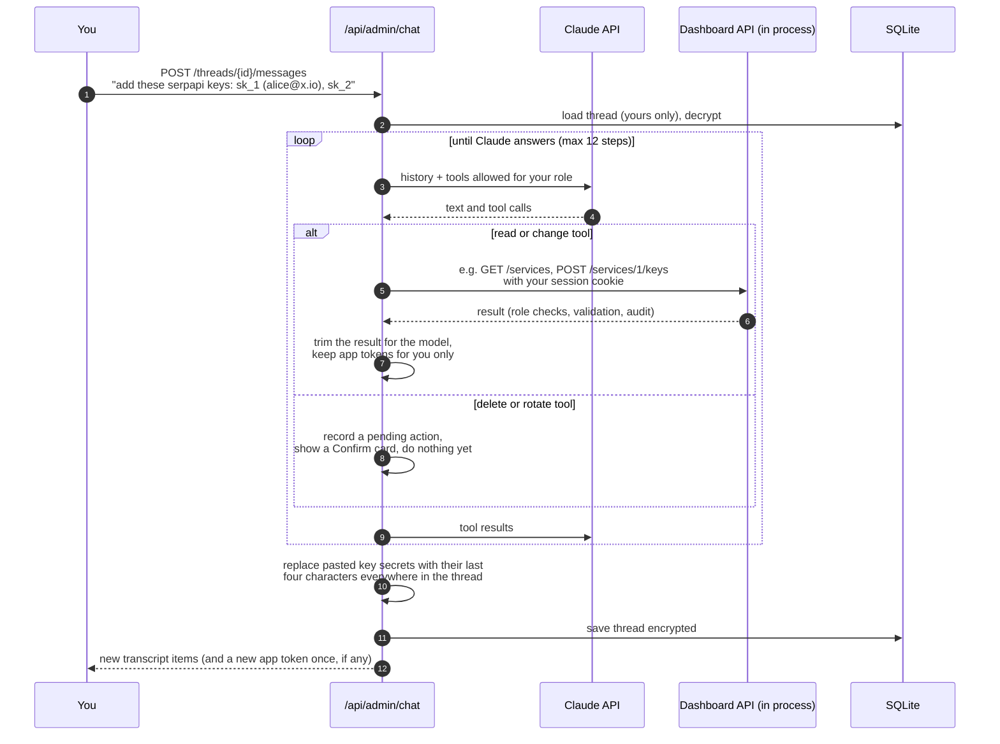

Typical "add keys" path the assistant follows:

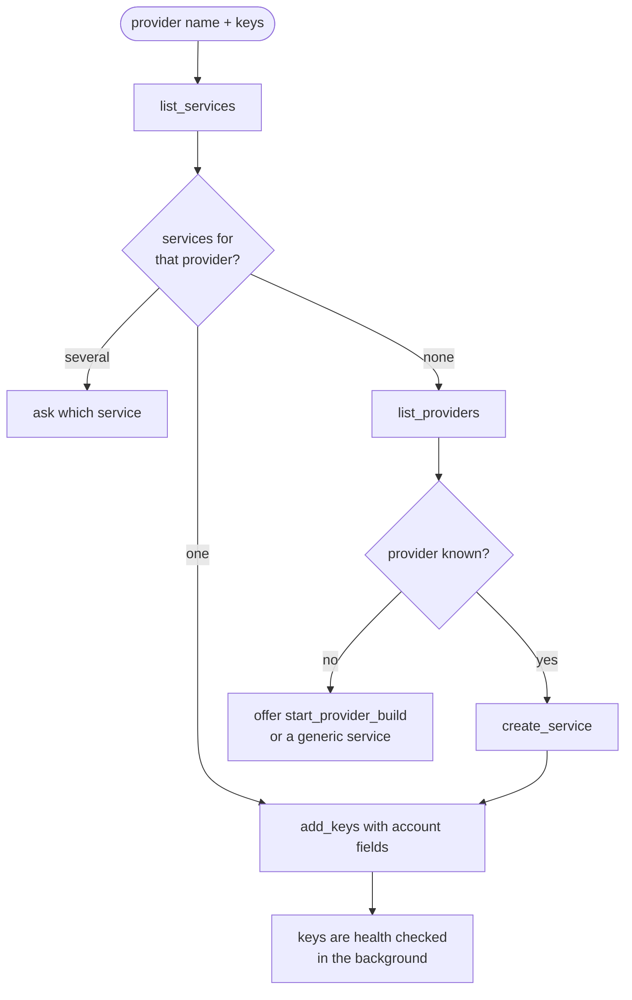

Confirmations:

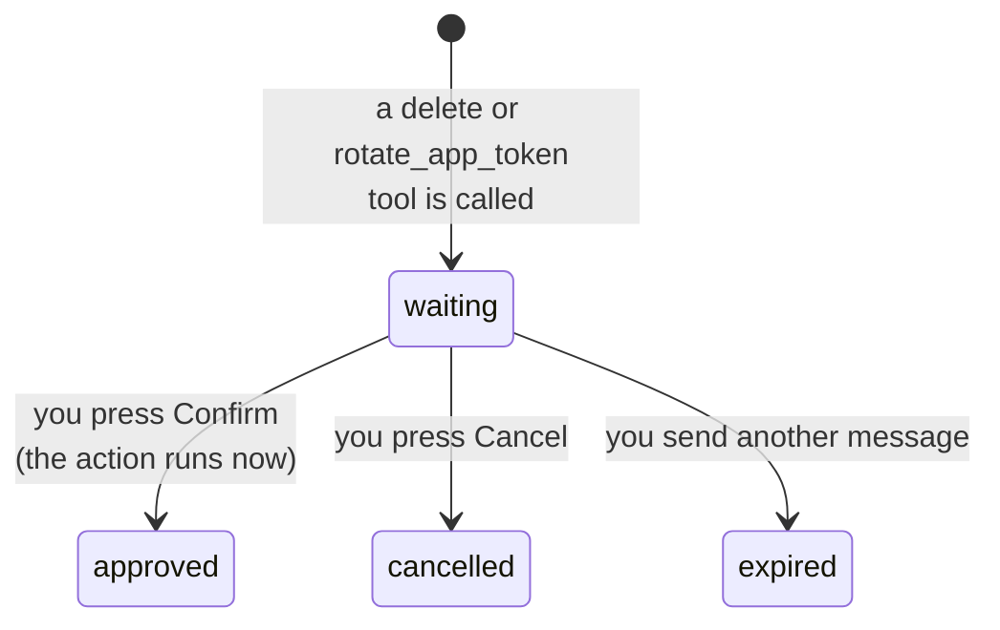

Tools by role:

| Role | Tools |
|---|---|
| member and up | overview, list_providers, get_provider, list_services, list_keys, key_details, list_apps, app_usage, list_events, list_webhooks, list_egress_proxies, list_groups, service_breaker, cache_stats, app_mcp_settings, get_ai_run |
| admin and up | create_service, update_service, add_keys, update_key, check_keys, reset_key, create_app, update_app (including limits), create_webhook, update_webhook, test_webhook, create_egress_proxy, update_egress_proxy, test_egress_proxy, create_group, update_group, reset_breaker, purge_cache, update_app_mcp, start_provider_build |
| admin and up, after Confirm | delete_key, delete_service, delete_app, rotate_app_token, delete_webhook, delete_egress_proxy, delete_group, enable_app_mcp_manage |

There is no tool to reveal a stored key, manage users or read the audit log.
New app tokens and webhook signing secrets are shown to you once and never
sent to Claude; egress proxy URLs are redacted from the stored chat like keys.
