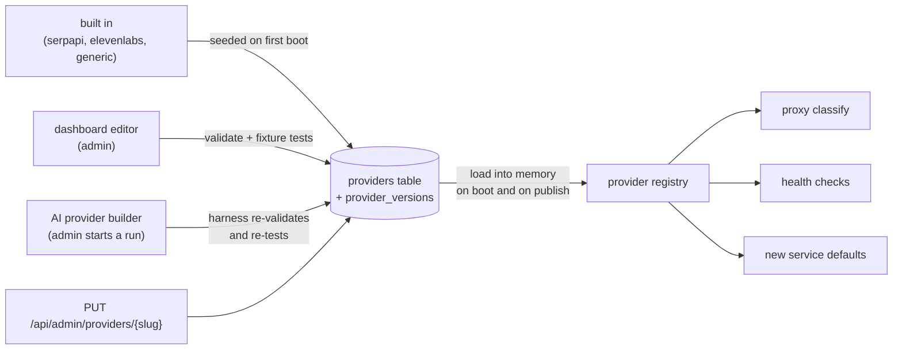

# Provider specs

A **provider** describes how one API works: where keys go, which responses
mean "this key is rate limited" or "out of quota", and how to check a key
without spending quota. Providers are data, stored in SQLite with version
history, so adding one needs no code change and no redeploy.

A **service** is a provider plus your settings and your keys. Several services
can share a provider (for example two SerpAPI pools for different teams).

## Where providers come from



Every publish bumps `version` and stores a snapshot, so any earlier version can
be published again with **Rollback**. Built in providers can be edited and
disabled but not deleted; other providers can be deleted once no service uses
them.

## Spec at a glance

```jsonc
{
  "base_url": "https://serpapi.com",
  "auth": { "type": "query", "name": "api_key", "prefix": "" },
  "defaults": { "strategy": "round_robin", "cooldown_sec": 3600, "max_attempts": 5,
                "max_concurrency": 0, "queue_timeout_sec": 0 },
  "quota": { "unit": "searches", "counts_per_request": true },
  "rules": [
    { "name": "Out of searches",
      "match": { "status": [429], "body_contains": ["run out of searches"] },
      "outcome": "quota_exhausted" }
  ],
  "use_standard_rules": true,
  "health": { "method": "GET", "path": "/account.json",
              "quota": { "limit": ["searches_per_month"], "remaining": ["total_searches_left"] } },
  "examples": [ { "name": "Search", "method": "GET", "path": "/search.json",
                  "query": { "q": "coffee" }, "safe": true } ],
  "tests": [ { "name": "out of searches", "status": 429,
               "body": "{\"error\":\"Your account has run out of searches.\"}",
               "expect": "quota_exhausted" } ]
}
```

| Part | What it controls |
|---|---|
| `base_url` | Default base URL for new services. Existing services keep their own. |
| `auth` | `query` (parameter `name`), `header` (header `name`) or `bearer` (`Authorization: Bearer`, or `name` with `prefix`). The proxy applies `prefix` when the service still uses the spec's placement, and leases return it in `auth.prefix`. |
| `defaults` | Strategy, cooldown, attempts and concurrency for new services. |
| `quota` | The unit shown in the dashboard, and whether each successful request uses one unit. |
| `rules` | Ordered matchers, first match wins. Fields in `match` are ANDed, values in a list are ORed, matching is case insensitive. `retry_after` reads a header, a fixed value, the next hour, or a JSON field (always capped at 24 hours). |
| `use_standard_rules` | Append 429 rate limited, 402 quota exhausted, 401/403 invalid. Anything else 5xx is `error`. |
| `health` | A free request that proves a key works and reads its quota. Without it, validity is learned from real traffic. |
| `examples` | Requests for the Integrate panel. Live checks only run `safe` GET or HEAD examples. |
| `tests` | Fixture responses with the expected outcome, run on every save. |

The full field reference is in the
[design spec](superpowers/specs/2026-11-01-providers-as-data-and-ai-builder.md#provider-spec).

## Adding a provider

1. **Dashboard**: Providers, New provider. Fill the form or paste JSON. Save
   validates the spec and runs its tests; a failing spec is not published.
2. **AI builder**: Providers, Build with AI. Give context, docs URLs and,
   optionally, a test key. Watch the run, then review or let it publish. See
   [the run flow](flows.md#ai-provider-builder).
3. **API**: `POST /api/admin/providers` with the metadata and spec, or
   `POST /api/admin/providers/validate` to check without saving.

Then create a service from the catalog and add keys.

## Validation rules

- `slug`: lowercase letters, digits and hyphens.
- `base_url`: http(s) with a host. `website` and `docs_url`: empty or http(s).
- `health.path` and example paths start with `/`, so they cannot change host.
- Rule regexes are RE2 (no catastrophic backtracking); JSON paths are depth
  limited.
