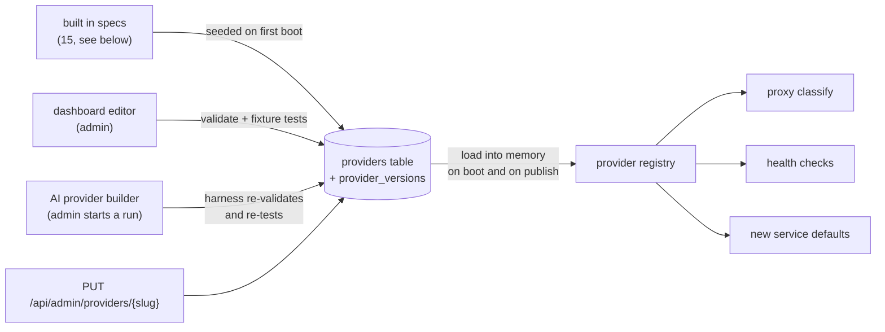

# Provider specs

A **provider** describes how one API works: where keys go, which responses
mean "this key is rate limited" or "out of quota", and how to check a key
without spending quota. Providers are data, stored in SQLite with version
history, so adding one needs no code change and no redeploy.

A **service** is a provider plus your settings and your keys. Several services
can share a provider (for example two SerpAPI pools for different teams).

## Where providers come from



Every publish bumps `version` and stores a snapshot, so any earlier version can
be published again with **Rollback**. Built in providers can be edited and
disabled but not deleted; other providers can be deleted once no service uses
them.

## Built in providers

SerpAPI, Serper, Brave Search, Tavily, Exa, Firecrawl, Jina, SearchApi,
Linkup, You.com, TinyFish Search, TinyFish Fetch, Google Gemini, ElevenLabs,
and a generic spec ("Custom API")
for any API that takes a key in a header, a bearer token or a query parameter.
They are seeded on first boot and edited like any other provider.

Some read quota without spending it: health checks call account endpoints
(SerpAPI `account.json`, ElevenLabs `/v1/user/subscription`), and providers
that send quota headers on every response, such as Brave Search, update it as
traffic flows (`quota.headers`).

TinyFish serves each product from its own host with one shared key
(`X-API-Key`), so Search (`api.search.tinyfish.ai`) and Fetch
(`api.fetch.tinyfish.ai`) are two providers. Add the same key to both
services. Both are free within their limits (see [Offers](#offers)).

Built in providers that were seeded by an older release get the offers this
release ships on the next boot, as long as nobody has edited them (version 1).

## Spec at a glance

```jsonc
{
  "base_url": "https://serpapi.com",
  "auth": { "type": "query", "name": "api_key", "prefix": "" },
  "defaults": { "strategy": "round_robin", "cooldown_sec": 3600, "max_attempts": 5,
                "max_concurrency": 0, "queue_timeout_sec": 0 },
  "quota": { "unit": "searches", "counts_per_request": true },
  "rules": [
    { "name": "Out of searches",
      "match": { "status": [429], "body_contains": ["run out of searches"] },
      "outcome": "quota_exhausted" }
  ],
  "use_standard_rules": true,
  "health": { "method": "GET", "path": "/account.json",
              "quota": { "limit": ["searches_per_month"], "remaining": ["total_searches_left"] } },
  "examples": [ { "name": "Search", "method": "GET", "path": "/search.json",
                  "query": { "q": "coffee" }, "safe": true } ],
  "tests": [ { "name": "out of searches", "status": 429,
               "body": "{\"error\":\"Your account has run out of searches.\"}",
               "expect": "quota_exhausted" } ]
}
```

| Part | What it controls |
|---|---|
| `base_url` | Default base URL for new services. Existing services keep their own. |
| `auth` | `query` (parameter `name`), `header` (header `name`) or `bearer` (`Authorization: Bearer`, or `name` with `prefix`). The proxy applies `prefix` when the service still uses the spec's placement, and leases return it in `auth.prefix`. |
| `defaults` | Strategy, cooldown, attempts and concurrency for new services. |
| `quota` | The unit shown in the dashboard, whether each successful request uses one unit, `headers` to read remaining quota from every response, and `cost_per_request` in USD for app budgets and the Usage page when no offer prices a request. |
| `offers` | Optional. Prices, free allowances and published limits per product or endpoint. See [Offers](#offers). |
| `rules` | Ordered matchers, first match wins. Fields in `match` are ANDed, values in a list are ORed, matching is case insensitive. `retry_after` reads a header, a fixed value, the next hour, or a JSON field (always capped at 24 hours). |
| `use_standard_rules` | Append 429 rate limited, 402 quota exhausted, 401/403 invalid. Anything else 5xx is `error`. |
| `health` | A free request that proves a key works and reads its quota. Without it, validity is learned from real traffic. |
| `examples` | Requests for the Integrate panel. Live checks only run `safe` GET or HEAD examples. |
| `tests` | Fixture responses with the expected outcome, run on every save. |

The full field reference is in the
[design spec](superpowers/specs/2026-11-01-providers-as-data-and-ai-builder.md#provider-spec).

## Offers

`offers` says what a provider charges and allows, per product or endpoint,
as its pricing page publishes it. It is optional, and specs without it work
as before.

```jsonc
"offers": [
  {
    "name": "TinySearch",
    "match": { "method": "GET", "path": "/$" },
    "free": true,
    "price": { "amount": 0, "currency": "USD", "unit": "request" },
    "limits": [ { "count": 30, "per": "minute", "unit": "requests" },
                { "count": 500, "per": "hour", "unit": "requests" } ],
    "notes": "Free up to 12,000 a day, then wallet funds.",
    "source_url": "https://www.tinyfish.ai/pricing",
    "checked_at": "2026-11-02"
  },
  { "name": "Agent runs", "match": { "method": "POST", "path": "/v1/automation/run" },
    "price": { "amount": 0.016, "unit": "step" }, "concurrency": 2 }
]
```

| Field | Meaning |
|---|---|
| `name` | The product name. Unique within the spec. |
| `match` | Which requests the offer covers. `method` (empty for any) and `path`, relative to the base URL: a prefix by default, `*` matches inside one segment, and a trailing `$` makes it exact. Or `examples`, a list of example names, which match that example's method and path exactly. Leave `match` out for a provider wide offer. |
| `price` | `amount` is USD (or `currency`) for one `unit`: request, search, query, url, page, step, minute, check, token, character, credit, image, second, session, run or gb. `$5 per 1,000` is `0.005`. `per_request` is how many units one request uses when that is fixed (1 credit). |
| `free` | Requests under this offer cost nothing. A free offer cannot have a price above 0. |
| `limits` | `{count, per, unit}` with `per` second, minute, hour, day or month (30 days). |
| `concurrency` | Requests one key may have in flight under this offer. |
| `notes`, `source_url`, `checked_at` | Plan differences and anything else worth knowing, the pricing page, and the date (YYYY-MM-DD) it was read. |

A request uses the first offer whose `match` selects it, plus every provider
wide offer. A lease never shows Acnologia the request, so it gets the
provider wide offers only.

How Acnologia uses offers:

- **Pacing.** Before calling upstream, the pool checks each key against the
  limits of every offer that applies. Windows are rolling and kept in memory
  per key: each is a ring of ten sub buckets, so memory stays fixed however
  high the limit, and counting the whole oldest bucket keeps the count
  conservative (a key may wait up to a tenth of the window longer than
  strictly needed, never less). A key at a limit counts as busy: the request
  tries another key, waits up to the service `queue_timeout_sec`, or answers
  503 `all_keys_busy` with `retry_after_sec` set to when a window frees. Each
  request or lease counts as one unit, so for limits counted in URLs or
  tokens, send one unit per request or treat the limit as approximate.
  Limits are enforced on every key, so list only limits that hold for every
  plan and put plan specific caps in `notes`.
- **Concurrency.** An endpoint offer's `concurrency` caps that endpoint's
  in flight requests per key. A provider wide offer's `concurrency` becomes
  the per key slot limit when neither the key nor the service sets one.
- **Cost.** A successful request costs the service's `cost_per_request`
  override if set, else the matching offer's price (free offers cost 0, a
  unit such as `request` or `url` counts once, `per_request` multiplies),
  else `quota.cost_per_request`. Prices in units that vary per request
  (tokens, minutes) without `per_request`, or in another currency, fall back
  to `quota.cost_per_request`. The Usage page and app budgets use this cost.
- **AI and people.** The AI builder reads the provider's pricing page and
  fills offers with `source_url` and `checked_at`. The Assistant's
  `provider_offers` tool answers questions such as which search provider is
  free. Catalog and provider cards show a Free badge, the service page lists
  "Offers and limits", Copy for LLM includes them, and MCP service tools
  name the free offer and its limits.

Built in offers come from each provider's pricing and rate limit pages,
checked 2026-11-02. Where a page publishes nothing for a value, the value is
left out.

## Building a provider with AI

Set `ANTHROPIC_API_KEY` to turn this on. Give the builder a name and a docs
URL or GitHub repo, plus a test key if you have one. An agent on the Claude API
then:

1. reads the official docs (web search, web fetch, GitHub),
2. writes the whole provider: metadata, auth, defaults, rules, health check,
   examples and tests,
3. validates it and runs the tests through the real engine, plus a live check
   with your test key,
4. finds the logo on the provider's website,
5. publishes it and adds a service to the catalog.

You watch every step live. Without auto publish, the draft waits for your
review. The guardrails are in code, not in the prompt:

- Specs are data and cannot execute.
- The harness re-validates and re-tests every submission itself, and a failing
  test blocks publishing.
- Logo fetches and live checks cannot reach private networks.
- Test keys are encrypted, never shown to the model (see
  [security](security.md#what-the-model-can-and-cannot-see)), and wiped when
  the run ends.
- A run stops after 40 turns, and its web searches and fetches are capped.

Admins can delete a finished run, or remove every failed, cancelled and
published run at once with **Clear finished**. Runs still working are refused
with 409, runs waiting for review are kept by Clear finished, and the spend
they recorded stays on the Usage page.

**AI rules** (Settings) is your own policy text that every AI action follows,
for example "always set max_concurrency for voice APIs".

## Adding a provider

1. **Dashboard**: Providers, New provider. Fill the form or paste JSON. Save
   validates the spec and runs its tests; a failing spec is not published.
2. **AI builder**: Providers, Build with AI. Give context, docs URLs and,
   optionally, a test key. Watch the run, then review or let it publish. See
   [the run flow](flows.md#ai-provider-builder).
3. **API**: `POST /api/admin/providers` with the metadata and spec, or
   `POST /api/admin/providers/validate` to check without saving.

Then create a service from the catalog and add keys.

## Validation rules

- `slug`: lowercase letters, digits and hyphens.
- `base_url`: http(s) with a host. `website` and `docs_url`: empty or http(s).
- `health.path` and example paths start with `/`, so they cannot change host.
- Offers: names are required and unique, a `match` needs a method, a path or
  examples, paths start with `/`, example names must exist, price units come
  from the list above, limits need a count of at least 1 and a known window,
  `checked_at` is a date and `source_url` is http(s).
- Rule regexes are RE2 (no catastrophic backtracking); JSON paths are depth
  limited.
