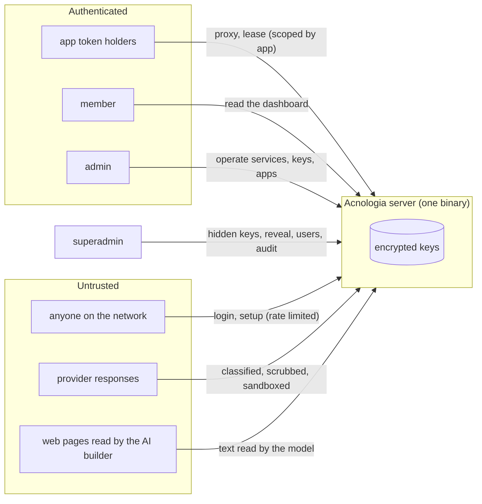
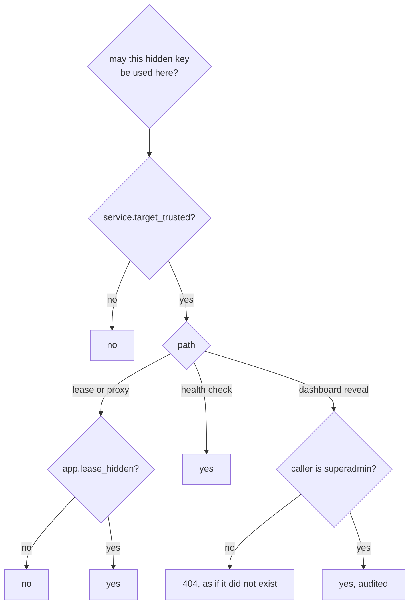
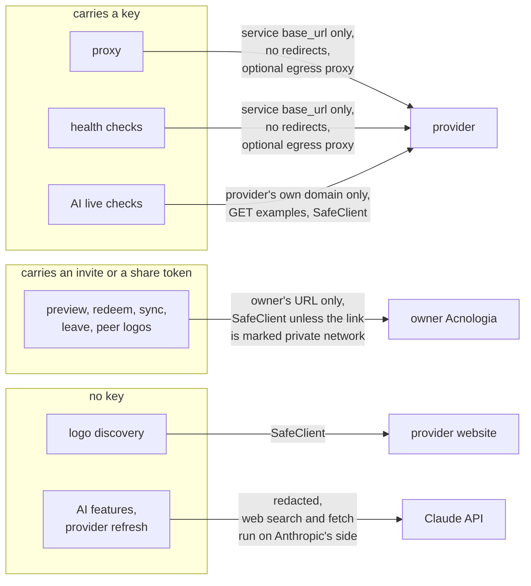

# Security model

Acnologia holds other people's API keys, so most of its design is about who
can make a key leave the server, and where it can go. This page states what
is protected, how, and where the protection stops.

## At a glance

**What is protected:** the provider keys stored on the server, and the
tokens that reach them.

**What holds:**

- Stored keys are encrypted with AES-256-GCM under a master key, and the
  server refuses to start when the master key does not match the database.
- An app in proxy mode is never handed the key. The server attaches it on
  the way out and scrubs its raw, query escaped and path escaped forms from
  response headers for every caller, and from response bodies for every
  caller that may not lease it.
- Members and admins never see hidden keys. A hidden key serves only apps a
  superadmin cleared, and only at services whose target a superadmin
  confirmed.
- Every request to the AI model passes one redactor that replaces stored
  keys and other known secrets, plus text shaped like common credentials
  (exceptions in [What the model can and cannot see](#what-the-model-can-and-cannot-see)).
  The same redactor runs on logs, events, the audit log and webhooks.
- A share in proxy mode gives the other side a token, never a key. Revoke,
  pause and expiry are checked on every request.
- Roles are re-read on every request, so a demotion takes effect at once.

**Where a key does leave the server, by design:**

- A lease (an app in `lease` or `both` mode, or the MCP `get_key` tool)
  returns the plain secret to the app.
- A superadmin can reveal a key in the dashboard. Each reveal is audited.
- A handover share sends keys to another server, and a reveal share shows
  them to a person. Neither can be taken back: rotate those keys at the
  provider when the share ends.
- Any key that is not hidden is effectively readable by admins, because an
  admin can route it to an app or a host they control. See
  [Hidden keys](#hidden-keys-admins-operate-but-never-read-them).

**Who is trusted:** superadmins, fully. Anyone holding both the database and
the master key can decrypt every stored key. Provider responses, text that
apps report, web pages the AI features read, and other servers are treated
as untrusted input.

**Where it stops:** upstreams on loopback and private addresses are allowed,
an egress proxy resolves host names itself, the redactor can miss a short
secret that is neither stored nor shaped like a credential, and the items
under
[Known limitations](#known-limitations).

## Trust boundaries

## Roles

| Can | member | admin | superadmin |
|---|:-:|:-:|:-:|
| See services, non-hidden keys, events, apps, providers | yes | yes | yes |
| Add, edit, delete services, keys, apps, providers; run checks; AI runs | no | yes | yes |
| See, create, hide or delete **hidden** keys | no | no | yes |
| Let an app use hidden keys (`lease_hidden`) | no | no | yes |
| Reveal a key's secret in the dashboard | no | no | yes |
| See Settings, AI models and prices, provider refresh runs and reviews, shares and peers | no | yes | yes |
| Manage users, read the audit log, set AI rules | no | no | yes |
| Switch AI models, edit model prices | no | no | yes |
| Change provider refresh settings, run it, Check now, apply or dismiss a review | no | no | yes |
| Create, edit, pause, resume and revoke shares; connect, sync and disconnect peers | no | no | yes |

Roles are re-read from the database on every request, so a demotion or a
disable takes effect immediately. At least one active superadmin always
remains.

## Apps and key flags

Each app has its own token (stored as a hash), a list of services it may use
(empty means all) and a mode: `proxy`, `lease` or `both`. An app learns
whether a service has a key available, never how many keys exist. Renewing a
lease checks the app's access again, so an app whose mode, services, hidden
key grant or share scope changed cannot keep a key (or an exclusive hold on
it) by renewing; the lease ends. A lease that rotates through a report is a
new lease and obeys the app's request and budget limits.

Each key can carry flags:

- `hidden`: visible only to superadmins, and handed only to apps a superadmin
  cleared with `lease_hidden` (below).
- `restricted`: serves only the apps you name on the key.
- `disabled`: stays stored but is never handed out. Only a person moves a key
  out of it (or out of `banned`): proxy results, health checks and app
  reports never change its status.
- `backup` tier: serves only when every primary key is cooling, busy or out
  of quota.

## Hidden keys: admins operate, but never read them

An admin can create apps and edit services. Leasing a key returns the plain
secret, and a proxied provider can echo the key back, so **any key an admin can
route to an app or a host they control is effectively readable by that admin**.
Non-hidden keys are therefore readable by admins. Use `hidden` for keys they
must never see. Two flags enforce this:

- **`apps.lease_hidden`**: only apps a superadmin marked may use hidden keys,
  through a lease or the proxy. Admins cannot set it. When anyone other than a
  superadmin rotates the app's tokens or adds a token, the flag is cleared,
  because that person now holds a working token. An app edit writes only the
  fields it sends, so a slow edit cannot bring the flag back after that.
- **`services.target_trusted`**: when a service's base URL, auth placement,
  provider or egress proxy changes without a superadmin confirming it, the
  service becomes untrusted, and hidden keys are not sent to it by the proxy,
  leases or health checks. A superadmin confirms the target by saving the edit
  form, which sends `target_trusted: true`; nothing sets the flag implicitly.
  An Assistant tool call carries the superadmin's session but the model's
  choice, so it can never confirm a target. The dashboard shows a banner while
  hidden keys are paused.
  A provider spec decides part of the target too: its `auth` and its health
  check's `method`, `path`, `query` and `from_origin` say where a health check
  sends each key. When anyone other than a superadmin acting in person (an
  admin, the Assistant, an AI run, a rollback by an admin) publishes a spec
  that changes any of those, every service of that provider loses
  `target_trusted`, before the new spec goes live, and each one gets a
  `service.untrust` audit entry naming what changed. A superadmin's own edit,
  and a peer owner's spec pulled by a superadmin, keep it.

Hidden keys and their traffic are also left out of everything a non-superadmin
sees: key lists, counts, events, request totals, and the events of a deleted
hidden key. A hidden key's events are deleted with it however it goes (its own
delete, its service's delete, or a peer link revoke or disconnect removing it),
since nothing would mark them hidden once the key row is gone.

A health check sends the secret to the service's base URL, so a key is only
ever checked against its own service, and MCP `check_keys` needs a service.
Its path may only add to that base URL: a spec's `health.path` must start with
`/` and may not hold `.` or `..` segments, raw or percent encoded, and
`health.from_origin` (which drops the base URL's path) is refused when the
base URL has a path, except for the built in peer provider's manifest check.
Both rules are checked when a spec is saved and again on every check, against
the service's own base URL.

## Secrets at rest

| Item | Stored as |
|---|---|
| Provider keys | AES-256-GCM with a random nonce per write, plus a keyed HMAC fingerprint for duplicate detection |
| AI run test keys | Same encryption, wiped when the run ends |
| Passwords | bcrypt (10 to 72 characters) |
| Session and app tokens | SHA-256 of 32 random bytes. An app can hold several tokens in `app_tokens`, each revocable and optionally expiring; a revoked or expired token gets 401. |
| Share tokens | On the owner, the SHA-256 like any app token. On the receiver, encrypted like a provider key. |
| Server identity | Ed25519 private key, encrypted with the master key in `meta` |
| Master key | `ACNOLOGIA_MASTER_KEY`, else `data/master.key` (0600, generated on first boot) |

The server refuses to start when the master key does not match the database
(checked through `meta.master_key_check`, or by decrypting a stored key on
databases from before that check). It never generates a new key over an
existing file it failed to read. The data directory is chmod 0700 and the
database files 0600.

Windows ignores those modes, so there the folder's ACL does the job:

- The default data directory, `%LocalAppData%\Acnologia`, inherits the ACL
  of your profile, readable only by you, SYSTEM and administrators.
- A data directory you choose elsewhere (`C:\ProgramData\Acnologia` for a
  service, say) inherits that folder's ACL, which often lets every local
  user read it. Restrict it with `icacls` (see
  [configuration](configuration.md#windows)), or `master.key` and the
  database are readable by anyone signed in to the machine.
- `acn` keeps its token in `%AppData%\acnologia\ctl.json`, under the same
  profile ACL.

## Keeping keys out of places people can read

- Upstream error text, health check errors and lease report messages are
  scrubbed of the key (raw, query escaped and path escaped forms) before they
  are stored in `last_error` or events, or logged.
- Request logs record the path only, never the query string.
- Proxied response headers are scrubbed of the key, so a redirect that keeps
  the query string cannot hand a query-auth key to the app.
- Requests that carry a key never follow redirects (Go would forward custom
  auth headers like `xi-api-key` to the new host).
- The SDKs scrub the secret from failure reports and redact it when a lease or
  client is printed.

## What a proxied caller sees and can change

The caller shapes a proxied request (path, query, headers, body) and reads
what the upstream says back, so the proxy treats both directions as the
caller's:

- **The key stays out of answers.** A caller that may not lease the key (a
  share's or a person's token, a proxy only app, any caller of a peer or
  handover service) gets bodies with every spelling of the injected key
  (raw, query escaped, path escaped) replaced by `[key]`, whether streamed,
  buffered, cached, replayed or relayed as an error. Response headers are
  scrubbed for every caller. An app that may lease the key gets the body as is.
- **No key ids for shares.** Share and person tokens get no
  `X-Acnologia-Key-Id` or `X-Acnologia-Attempts`, and the MCP `proxy_request`
  tool leaves `key_id` out for them.
- **No made up Acnologia headers.** Upstream `X-Acnologia-*` and `X-Cogito-*`
  headers are dropped, except from the owner of a shared service. A receiver
  marks its link revoked, paused or expired only when the owner's 403 carries
  both the header and the matching `share_*` error code, which an answer the
  owner relays from its upstream cannot.
- **Limits hold under bursts.** An app's or share's request and budget limits
  are checked and one request (and its estimated cost) reserved in one step
  before the upstream call, for the proxy, MCP `proxy_request`, leases and
  `get_key`, and released once the usage is recorded. Concurrent requests
  cannot pass a limit that has one request left.
- **Operators win over late results.** A request picked before an admin
  disabled a key, or before a key was banned, cannot write `invalid` or
  `exhausted` over that status when its answer lands.
- **One caller cannot retire a shared key.** An answer classified as invalid,
  banned or exhausted only lands on the key when something the caller does
  not shape agrees: the provider's health check, run right then on that key
  (at most once a minute per key), finds it invalid or out of quota, or a
  second app got the same verdict for the key within 10 minutes. Until then
  the request moves on to the next key, the key keeps serving everyone else,
  and its last error reads `unconfirmed invalid: ...`. A success on the key
  clears the suspicion. Providers without a health check therefore need two
  apps to agree before a key is marked dead; check such keys from the
  dashboard if a single app reports trouble.

### The response cache

The cache is shared by the apps of a service, so Acnologia never caches
a response made with a hidden or restricted key, a response the upstream marks
`private` or `no-store`, a partial (206) answer, or a body that contains the
key. An entry is keyed by the service id and slug, the method, path, query and
`Accept`, and a hash of every other forwarded header and the body, so one app
cannot plant an answer for a request that differs from its own. A share's app
gets entries of its own and never reads or writes what other apps see.
Idempotent replays are stored per app. Deleting a service or an app drops its
cached answers and replays, since SQLite can give the id to the next row.

## Admin API tokens and the CLI

Admin API tokens (`acnadm_`) are stored as SHA-256 hashes, carry a scope that
never exceeds their owner's role, stop working when the owner is disabled, and
cannot create tokens or change the account (a token may revoke itself, which
is how `acn logout` works).

`acn login` gets its token through a device flow (details in
[Command line](cli.md#how-the-sign-in-works)):

- The CLI's device code is 32 random bytes, kept only as a SHA-256 hash, in
  memory, for 10 minutes.
- The person approves the 8 letter user code on `/cli/authorize` with a
  dashboard session past the site lock, picking a scope no higher than their
  role. An API token cannot approve a sign in.
- The token (90 days, named `acn on <hostname>`) is audit logged as
  `token.create`.
- Creating, polling and wrong user codes are rate limited per client address
  or per user under a global ceiling. One address creates 5 a minute and 50
  a day (30 a minute from all, with no global daily cap) and holds at most
  10 waiting requests. Only polls for unknown codes count. One user gets 10
  wrong codes a minute, after which only that user is refused.

The CLI treats the server it talks to as untrusted input:

- `acn login` opens the sign in link only when it is http or https on the
  host that was typed (never a downgrade from https, never with user info).
  Any other link (another host, `file://`, a local or UNC path, a custom
  scheme) is not handed to the OS launcher; the CLI prints
  `<server>/cli/authorize?code=...` instead.
- `ACNOLOGIA_ACCESS_PASSWORD` is sent only to the server named by
  `ACNOLOGIA_ACCESS_URL`, or else `ACNOLOGIA_URL`, never to a server being
  signed in to or another saved one, and it is dropped from a redirect to
  another origin.
- Text from the server (labels, last errors, event details, error messages)
  is printed with control characters, bidi overrides and invalid UTF-8
  escaped, so a lease report or a peer's key label cannot drive the terminal.
  `--json` output escapes them inside strings.

## Assistant chat

- Tools call the dashboard API in process with your own session, so the
  assistant can never do more than you can, and its changes appear in the
  audit log under your name. Members are offered read tools only.
- Deleting keys, services or apps, rotating app tokens and revoking an app
  token run only after you press Confirm; a confirmation expires when you send another message.
- So do changes that decide where keys go or who may use them, since text the
  model reads (an event detail an app reported, a key note) could ask for
  them: an app's mode or allowed services, a service's base URL, auth or
  egress proxy, a key's egress proxy, and creating or changing webhooks and
  egress proxies. The card states the result in full, such as "all services".
- There is no tool that reveals a stored key secret. Tool results sent to
  Claude never contain secrets, and new app tokens are shown to you once and
  never sent to Claude or stored.
- Keys you paste never reach Claude. Before a message goes to the model,
  Acnologia finds the keys in it (the paste parser, then the pattern detector
  for keys inside URLs, after `Bearer`, in JSON fields or glued to text),
  encrypts each one into the thread's vault and puts a placeholder such as
  `[key k3 ...c21e]` in its place. Tools resolve the placeholders on the
  server. Your own message is stored as the prose without the keys, plus a
  list of label and last four characters. Threads are encrypted at rest with
  the master key and visible only to their owner.
- Key account fields (email, phone, name) are personal data: members see them
  empty, and they are not written to events or the audit log.

## What the model can and cannot see

Every request to Anthropic, from the Assistant and its compaction summaries,
the provider builder, Fill with AI, run naming and the provider refresh,
goes through one HTTP middleware on the shared client
that rewrites the request body before it leaves the server:

- Known secrets are replaced by `[key ...c21e]`: every pool key, webhook URL
  and secret, and egress proxy URL (decrypted once into a multi pattern
  matcher and reloaded when one changes), plus `GITHUB_TOKEN`, the builder
  run's test keys and the keys a chat turn handled. Raw, query escaped and path escaped forms
  are matched. Values shorter than 8 characters are not matched exactly.
- Unknown secrets are replaced by `[secret ...c21e]` by pattern: common
  prefixes (`sk-ant-`, `sk-`, `AIza`, `ghp_`, `xox`, `tvly-`, `AKIA`,
  `sk_live_`, JWTs, Acnologia's own `acn_` and `acnadm_` tokens and the
  older `cog_` and `cogadm_` ones), `Bearer` and `Basic`
  credentials, auth headers, `key=`, `api_key=`, `token=`, `secret=` and
  `password=` in URLs, env lines and JSON, and long random looking tokens.
  Hex hashes, UUIDs, words, identifiers and paths are left alone.
- The system prompt, your messages and every tool result get both passes.
  Replayed model output gets the known pass only; thinking blocks and web
  search and fetch results are not touched, since the API checks their
  signatures. Tool definitions are not changed.

So Claude sees key hints, labels, statuses and quotas, but not a secret,
including a key an upstream echoes in an error or a live check. The builder's
live checks use the test key on the server; the model gets the result with
the key replaced.

The same redactor runs where text is stored or sent: agent steps and run
errors, run notes, events, the audit log, key `last_error`, webhook payloads
and delivery errors, and every log line (a wrapping `slog` handler).

Limits: a short key with no prefix and no `key=` in front of it (a bare 12
character token in a sentence) is caught only if it is already a pool key or
the paste parser finds it. Leasing a key, through the API or the MCP
`get_key` tool, returns the secret to the app by design; use proxy mode for
any client you would not hand a key to.

## AI models, prices and provider refresh

- **Switching models** is a superadmin action, audited as `ai.models`. Only
  model ids from Anthropic's list or the built in table are accepted, and
  every model is reached through the same client and redactor, so picking a
  model changes cost and quality, never what leaves the server.
- **Model price overrides** are superadmin only and audited as `ai.prices`
  with the old and new values. They change how Acnologia counts the cost of
  its own Claude calls (the Usage page) and, for a context window override,
  when an Assistant chat compacts. They never touch provider keys, offers or
  app budgets.
- **The provider refresh never sends a key.** The refresh model gets the
  provider's name, URLs, example names and current offers, and reads public
  pricing pages through `web_search` and `web_fetch`, which run on
  Anthropic's side, so no page is fetched from Acnologia's network. The
  Claude price refresh reads Anthropic's pricing page the same way. Every
  request passes the redactor above.
- **A refresh can only change offers.** Never auth, the base URL, rules,
  health checks or tests, so a misread or hostile page cannot redirect keys.
  The pages it reads are untrusted, so the bounds are in code: a change
  applies on its own only when it moves existing offers' prices within 4x or
  loosens their limits, and every changed offer cites a page on the
  provider's own website, docs or API domain. New or removed offers, a
  changed match, notes or free flag, and any tighter limit or concurrency
  wait for a superadmin, so a hostile page cannot throttle every key or zero
  a price unseen. A no change check only moves `checked_at` and never
  reorders the stored offers. Names and notes are stripped of control and
  invisible characters, a `source_url` with user info is dropped, and later
  checks start only from cited pages on the provider's own domains. Claude
  price changes apply on their own only from an https page on anthropic.com
  or claude.com (the only sites that refresh may read) and within 4x of the
  current price. Each applied change is a provider version you can roll
  back, with a webhook and an audit entry.
- **Spend is capped**: per run (default $2) and per month (default $5) for
  the refresh feature, checked before each provider. Only one run goes at a
  time.
- **Providers copied from a peer are skipped** unless a superadmin turns
  them on.

## The AI builder

The builder's `web_search` and `web_fetch` tools run on Anthropic's side, so
fetched pages never reach Acnologia's network. Its `github_read` tool validates
owner, repo and path. Text from fetched pages can steer the model, so its
output is checked rather than trusted: the harness re-validates and re-tests
every submitted spec, a create run cannot overwrite an existing provider,
update runs wait for review by default, and the test key only goes to the
provider's own domain.

How the test key stays on that domain:

- **Pinned to what the operator vouched for.** The key goes only to the
  registrable domain of a URL the operator gave, or of the provider being
  updated. A host on a shared hosting platform (`vercel.app`, `github.io`,
  `supabase.co`, `workers.dev`, `amazonaws.com` and similar) pins only that
  tenant's own host, and an IP address only itself.
- **Nothing to pin to, no key sent.** A create run with no docs URL (or only
  a GitHub link) never sends the test key. The draft is accepted without a
  live check and waits for review even with auto publish on, because
  publishing creates a service at `base_url` holding the test keys; the
  review step names the host to confirm.
- **Only a valid spec runs live.** `live_check` refuses a draft with schema
  problems, so every health and example path starts with `/` and the health
  method is GET or POST. The live check client also refuses any request whose
  host, scheme or user info differs from `base_url`'s, and the engine's health
  check does the same, so a path such as `@attacker.example/x` cannot move
  the key to another host.

## Web protections

- **Access password** (optional, for an instance on the internet): with
  `ACNOLOGIA_ACCESS_PASSWORD` set, a lock screen comes before setup, sign in
  and every dashboard route. Open while locked: the app shell, `/healthz`,
  `/robots.txt`, `/api/gate*`, the landing page's GitHub star count, the
  app token routes (`/proxy/*`, `/api/v1/*`, `/mcp`), the CLI sign in's
  create and poll calls, and the sharing routes, which need an invite, a
  share token, a claim code or the owner's signature. Every other route is
  locked, including routes added later, and a path with dot segments or an
  escaped form cannot borrow an open prefix. A valid admin API token passes
  the lock on its own. The `acnologia_gate` cookie is an issue time plus an
  HMAC keyed by the master key and the password, refused once it is older
  than `ACNOLOGIA_ACCESS_TTL` (30 days by default). Wrong guesses, on the
  lock screen or in `X-Acnologia-Access`, are limited to 5 a minute and 50 a
  day per client address, under a global ceiling of 20 a minute, so a flood
  makes the owner wait a minute at most unless it comes from the owner's own
  address. See [configuration](configuration.md#access-password).
- **No indexing**: every response carries `X-Robots-Tag: noindex, nofollow,
  noarchive, nosnippet` and `/robots.txt` disallows everything.
- **CSRF**: every mutating dashboard call must send `Content-Type:
  application/json` or `X-Requested-With`, both of which force a CORS
  preflight. This holds for bodyless calls too. The session cookie is
  `HttpOnly` and `SameSite=Lax`.
- **Content Security Policy**: the dashboard allows scripts only from itself
  plus the exact inline scripts in `index.html`, by SHA-256 hash computed at
  startup. Framing is denied.
- **Proxied responses** are served from the dashboard origin, so they get
  `Content-Security-Policy: sandbox; default-src 'none'`, `nosniff` and
  `X-Frame-Options: DENY`, and upstream `Set-Cookie`, CORS and security
  headers are dropped.
- **Logos** are served with their sniffed type, `nosniff` and a sandbox CSP,
  and the UI only ever shows them through ``.
- **Links** from provider data are rendered only when they are `http(s)`, and
  the server rejects other schemes for provider `website` and `docs_url`.

## Abuse limits

| Limit | Value |
|---|---|
| Sign in attempts | 10 per 10 minutes per client address (an IPv6 /64 counts as one) and per existing account, counted before the password check so a parallel burst gets no more; a success clears them. Account counters are never dropped to make room |
| Dashboard JSON body | 4 MB, read within 30 s or the connection closes |
| Connections | headers within 15 s; an idle keep-alive closes after 2 minutes. No overall read or write timeout, so long streams are not cut |
| Proxy request body | `ACNOLOGIA_MAX_BODY_MB` (default 50) |
| Proxy methods | GET, HEAD, POST, PUT, PATCH, DELETE, OPTIONS |
| Proxy idle stream | 5 minutes without bytes ends the response and frees the slot |
| Cooldown from a report or `Retry-After` | 24 hours |
| Lease wait / TTL | 60 s / 24 h |
| Late lease report | refused 10 minutes after expiry |
| MCP tool result | `max_result_kb` per app, default 200 KB, at most 2048 |
| AI runs | 2 at a time, 40 turns, 30 minutes, 5 live checks, 3 submits |
| Assistant | 24 model steps and 15 minutes per message, messages up to 1 MB (a dropped file of keys), one message at a time per chat |

The client IP comes from the socket unless `ACNOLOGIA_TRUST_PROXY_HEADERS=true`.
Behind a reverse proxy, enable it, or every client shares one budget on each
per address limit: sign in, the lock screen, the CLI sign in, invites, claim
links and revoke pushes. An IPv6 address counts by its /64.

## Outbound requests

A service's base URL is the admin's choice, so the proxy and health checks
refuse to connect to link local addresses (169.254.0.0/16, fe80::/10), the
cloud metadata endpoints (169.254.169.254, fd00:ec2::254, 100.100.100.200)
and unspecified addresses, including IPv4 embedded in IPv6. The check runs in
the dialer on the resolved address of every connection, so a host name that
resolves there, now or after a DNS change, is refused too. The proxy answers
`502 upstream_blocked` with "refusing to connect to a link-local or metadata
address", and a health check records the same error. Loopback and private
(RFC 1918, fc00::/7) addresses stay allowed, because self hosters proxy to
model servers on their own machine or network; there is no setting for this.
Behind an egress proxy or `HTTPS_PROXY` the dialer only sees the proxy, so
Acnologia refuses a proxy at one of those addresses and a request URL that
names one literally, but a host name is resolved by the proxy, which reaches
whatever it can. Admins can add egress proxies; only use proxies that cannot
reach your metadata service.

`SafeClient` checks the resolved address at dial time, which also defeats DNS
rebinding, and refuses loopback, private, link local (including cloud metadata
at 169.254.169.254), CGNAT, benchmark, documentation and reserved ranges, plus
NAT64 and 6to4 addresses that embed one of those.

Webhook deliveries carry no key and go through `SafeClient` unless
`ACNOLOGIA_WEBHOOK_ALLOW_PRIVATE=true`. Webhook URLs are encrypted at rest (Slack,
Discord and Telegram URLs are secrets) and only a host hint is ever returned.
Hidden keys never produce webhook events. Messages carry text other people
chose (peer server names, share and key labels, an app's lease report), so
Slack messages escape `<`, `>` and `&` and Discord messages escape markdown:
that text cannot ping a channel or show a link under a label it picked.
Telegram messages are sent without a parse mode, as plain text.

An egress proxy sees which hosts keys travel to, and the keys themselves when
a service's base URL is plain `http`. Assigning one is therefore part of a
service's target: assigning or changing it without an explicit superadmin
confirm clears `target_trusted`, so hidden keys stop flowing until a
superadmin confirms.
Proxy URLs are encrypted at rest and shown without credentials.

## Sharing between servers

A share lets another Acnologia use some services through this server's proxy.
In the default proxy mode the other server is a client with a token, never a
holder of keys. A handover share is the exception, covered at the end of this
section.

- **No secret leaves the owner (proxy mode).** The receiver gets a share token, a manifest
  and answers to its proxied requests. The manifest holds the share's name,
  status, limits and expiry, each shared service's name, description,
  provider and how many keys in its key scope can take a request now, and
  the provider specs (which hold no secret). Never a key, its hint, its
  label, its count by status, or which key served a request. Hidden keys
  serve a share only when a superadmin turned on `include_hidden`, which
  sets `lease_hidden` on the backing app, and only while the service's target
  is trusted.
- **Key scopes hold on every pick.** A share limited to up to N keys or a
  picked list never gets a key outside it, through any path: the pool
  applies the scope for the backing app before choosing.
- **A share cannot take keys out of rotation.** A share holder shapes its own
  requests, so an invalid or banned answer to one does not change the key's
  status: the request moves on to another key in scope, and the health check
  finds a key that really stopped working. Otherwise a share could knock the
  owner's keys out for every app and walk an up to N scope onto the next key.
- **The backing app never grants everything.** An app with an empty service
  list may use every service, so a share's app always lists the shared
  services, or an entry that matches nothing for a provider only share. It is
  proxy only, hidden from the Apps page, and the app routes refuse to change it
  (409 `share_app`).
- **A share is bound to the services it was made with.** The share records
  the service id behind each shared slug. If an admin renames a shared
  service and gives the slug to another service or a group, the share's
  calls to that slug get 403 `service_not_allowed` on the proxy, leases,
  lease reports and MCP; it never reaches a group. Editing the share keeps
  the old binding for slugs it already had; remove and add the slug again
  to share the new service.
- **Invites are one time and short lived.** `acninv_` codes carry the owner URL,
  the share id and 32 random bytes; only the SHA-256 of the secret is stored and
  it is compared in constant time. Redeeming burns it in the same transaction
  that binds the peer. Preview and redeem count only refused invites: 10 a
  minute and 100 a day per client address, and 20 a minute and 500 a day
  from all. A valid invite never counts, so junk can never spend the budget
  a real invite needs.
- **An invite binds to the server that redeems it.** Redeem carries the
  receiver's public key and an Ed25519 signature over the owner's server id,
  the share id, the invite hash, a nonce and its id; the owner checks the id
  is derived from the key, refuses a signature made for another owner, and
  records that server on the share. An owner therefore cannot relay a
  receiver's signed redeem to a third server. Owners still accept the older
  messages without the owner id from receivers that predate it, and a
  receiver refuses to redeem at an owner too old to check the owner id. The invite is then spent, so
  a leaked code is worthless after the first redeem, and a share serves one
  receiver. The receiver checks that the owner's identity at redeem matches
  the one previewed.
- **Revoke is immediate.** Revoke deactivates the app and revokes its tokens in
  one transaction; the share check runs before the token check, so the next
  request is refused with `share_revoked`. Pause and expiry are checked on every
  request.
- **Tokens are kept like keys.** The owner stores only the token's hash. The
  receiver stores it encrypted with the master key (in the link and as the
  services' hidden key), it is in the redactor's list, `/keys/{id}/reveal`
  refuses it, and revoke or disconnect deletes it. `acninv_` codes are a
  redactor pattern too, so neither reaches logs, events, audit detail, webhooks
  or Claude.
- **Outbound calls.** Preview, redeem, sync and leave use `SafeClient` unless the
  superadmin ticked "this server is on my private network" for that link.
  Proxied calls and health checks go to the service's base URL, and for a
  link not on a private network they use a client that refuses non public
  addresses on every dial, so an owner whose host looked public at sync
  cannot rebind it to this server's network later.
- **Syncs never wait on the owner under a lock.** The manifest, handed over
  keys, usage reports and logos are fetched with their own timeouts and
  without the sync lock, which covers only local changes; logo fetches share
  a budget per sync and a missing logo is retried at most daily. A manifest
  is capped at 200 services and 200 providers. A slow or hostile owner
  cannot hold up other links, disconnect or revoke handling.
- **Names and slugs from a peer are checked.** Service slugs in a manifest
  must be valid slugs, and a new local service never takes a slug a local
  service group uses, so a share cannot shadow a group at `/proxy/{slug}`.
  The owner's server name and a receiver's name at redeem are kept to one
  line of up to 100 bytes without control characters.
- **Imported specs never change on their own.** A provider spec from a peer,
  whether shared on purpose or pulled in because a shared service uses it, is
  imported once with source `peer:<owner id>` and only when this server has no
  provider with that slug; an existing one is never overwritten. A newer owner
  version is only reported. Pulling it is a superadmin action, refused when the
  spec was edited here and confirmed separately when the base URL moves, so an
  owner can never point keys this server added to its provider somewhere else.
  The local service keeps provider `acnologia-peer` for classification and the
  token; the owner's provider only describes it.
- **Logos from a peer.** The share token is sent only to the owner's URL. The
  owner serves logos only for providers in that share's manifest. The receiver
  accepts an allowed image type up to 512 KB whose bytes match the declared
  type and serves it with the same sandboxing CSP as every logo.
- **No chains.** Services from a peer (provider `acnologia-peer`) cannot be
  shared onward and cannot be leased. As a second guard, each server adds one
  to `X-Acnologia-Hop` when it forwards to a peer (the proxy strips the
  header on every other request); a request that arrives with more than 3,
  or would leave for a fourth server, gets 508 `loop_detected`.
- **Roles.** Only superadmins create, edit, pause, resume, revoke, connect,
  sync and disconnect. Admins can view. Server to server routes sit outside
  the access password lock; they need an invite, a share token or (for a
  revoke push) the owner's signature.

### Key handover: what changes

A handover share is the one place a key secret leaves the server that owns
it, on purpose. The model there is different, and the dashboard and these
docs say so plainly.

- **What the receiver can do with a key.** Anything the provider lets the key
  do, for as long as the provider honors it. A receiver that does not
  cooperate (modified code, a copy of its database and master key, a
  debugger, a proxy that logs its own outbound calls) can keep the secret
  forever. Nothing in Acnologia can take it back. Request and budget limits
  cannot be enforced either, because the owner never sees the requests; the
  receiver's usage reports are cooperative.
- **Why the lease exists.** A cooperating receiver deletes every handed over
  key whose lease (1h to 7d) ended without renewal, on its own clock and
  with no network: the worker checks every minute and zeroes the ciphertext
  before deleting the row. So a receiver the owner can no longer reach, or
  that loses the owner, keeps a key at most one lease past the last renewal.
  The owner stops renewing on pause, expiry, revoke and scope changes.
- **Why the push exists.** Revoke (and a timer that revokes) sends a signed
  revoke to the receiver so a cooperating receiver deletes the keys now
  rather than at the next sync or the end of the lease. It is Ed25519 signed
  by the owner's identity key over the share id, the receiver id, a
  timestamp and a nonce; the receiver verifies it against the owner key it
  pinned when it connected, refuses timestamps more than 5 minutes off and
  remembers nonces until they would be stale anyway, so it cannot be forged
  or replayed. It is best effort; its outcome is recorded on the share. The
  route is public, so only failed attempts are rate limited: 10 a minute and
  100 a day per client address, and 20 a minute and 500 a day from all. A
  valid signed revoke never spends that budget, so junk from other addresses
  cannot hold back an owner's revoke.
- **Rotate after revoke.** Because the push and the lease only bind a
  cooperating receiver, the owner should rotate every handed over key at its
  provider after revoking. The revoked share carries a rotate checklist of
  every key the receiver ever held.
- **Sealing.** Secrets travel sealed with HPKE (X25519, HKDF-SHA256,
  AES-256-GCM) to the receiver's X25519 key, which the receiver signed into
  its redeem request. The HPKE info binds the share id, the key id and the
  receiver id, so a sealed key replayed to another server, another share or
  as another key does not open. Sealed blobs (`acnseal1_...`) are a redactor
  pattern and never appear in a manifest, log, event, audit detail, webhook
  or anything sent to Claude; handed over secrets on the receiver are in its
  redactor's list like any stored key. Because that list masks text
  everywhere, the receiver refuses a handed over secret shorter than 16
  characters or with spaces or non printable characters, so an owner cannot
  blank arbitrary words in the receiver's records.
- **An up to N scope hands over at most N keys, ever.** A key handed over
  cannot be taken back, so for a handover share a key that leaves rotation
  keeps its place in the scope: the receiver gets a new key only while fewer
  than N of the keys it was ever given still exist. Deleting a key frees its
  place.
- **On the receiver the key stays inside the proxy.** A handed over key is a
  hidden key of a service whose target the owner chose. Local apps use it
  only through the proxy; `/keys/{id}/reveal` refuses it, leases (REST and
  MCP `get_key`) refuse it even for apps with `lease_hidden`, it cannot be
  shared onward (its service is a peer service), and its secret, hidden flag
  and egress, and its service's base URL, auth, provider and egress, cannot
  be changed to send it elsewhere, also in the same request that changes the
  provider. Any local app may proxy it, so the proxy masks the key in
  response bodies of those services as well as in headers, in case the
  upstream echoes it. The assistant reaches keys only through
  these routes. A base URL from an owner that is not on a private network
  must resolve to public addresses, so an owner cannot aim the receiver's
  apps at its internal network.
- **Who decides.** Only a superadmin creates a handover share, and only a
  superadmin connects a receiver to one. A receiver from before this
  feature cannot redeem a handover share (it sends no box key).

## Sharing with people

A share with a person gives someone who does not run Acnologia access
through a one time claim link. In proxy mode the person is a client with a
token, like a receiving server; in reveal mode they get the raw keys.

- **Claim links.** A code is `acnclaim_` and 24 random bytes. Only its
  SHA-256 is stored, it is shown once (in the create or new link answer),
  and it is valid 1h, 24h or 7d. Redeem burns it in the same transaction
  that mints the token or records the reveal, so it works once even under
  parallel redeems; a new link kills the old one. Preview and redeem are
  limited like invites (only codes that open nothing count, per address and
  globally), answer with
  `Cache-Control: no-store`, and say only which of unknown (404), used (409)
  or expired (410) applies. A share revoked or past its timer before the
  claim refuses the link. `acnclaim_` is a redactor pattern, and the request
  log writes `/claim/[code]` for the page, so a code reaches no log, event,
  audit detail, webhook or Claude input. Anyone holding an unclaimed link can
  claim it: send it over a private channel and pick the shortest validity
  that works. The email on a share is a label; nothing is ever sent.
- **What a person's token can do.** It is an app token on the share's
  backing app, kept as a hash like any app token. It can call
  `/proxy/<service>` for the shared services only, within the key scopes,
  limits and timer; read `/api/v1/services` and `/api/v1/me`; and use `/mcp`
  with the core tools that do not hand out keys and the generated service
  tools.
- **What it cannot do.** Lease a key (the app is proxy only, so neither
  `/api/v1/lease` nor MCP `get_key` works) or see any key secret, hint or
  count by status. Use key insights or key management over MCP: a share's
  token never gets those tool sets, whatever the app's MCP settings say, and
  the Apps page cannot change a share's app. Reach any dashboard route (app
  tokens never pass `requireUser`, which takes a session or an `acnadm_`
  token) or the server to server routes (403 `not_a_share`). Outlive a
  pause, revoke or ended timer: the share check runs before the token check
  on every request.
- **Reveal: the threat model.** A revealed key has left the server for good.
  The person can use it for anything the provider allows, outside every
  limit, for as long as the provider honors it, and revoke cannot take it
  back; the dashboard and these docs say so plainly. What Acnologia does:
  reveal only the keys the scopes resolve to, and never hidden, restricted,
  disabled, invalid, banned or handed over keys (even with
  `include_hidden`); show them in exactly one answer, after the link is
  burned; record each key as revealed (`revealed_to` on the key,
  `revealed_keys` on the share, `share.revealed` audit and webhook per key
  with ids only); and when the share ends, list every revealed key in
  `rotate_checklist` and the `share.rotate_keys` audit entry. Rotate them at
  the provider. Only a superadmin creates a reveal share; prefer proxy mode.
- **Access password lock.** On a locked deploy the `/claim/<code>` and `/me`
  pages are the dashboard shell (which carries no data), `/api/claim/v1/*`
  is open and needs a claim code, and the person's own calls go through
  `/proxy`, `/api/v1` and `/mcp`, which were already open and need an app
  token. Nothing else opens: other `/api/*` routes, writes to the pages and
  dot segment tricks on the open prefixes stay locked.

## Operator checklist

1. Serve over TLS and set `ACNOLOGIA_SECURE_COOKIES=true`.
2. Behind a reverse proxy, set `ACNOLOGIA_TRUST_PROXY_HEADERS=true`.
3. Set `ACNOLOGIA_MASTER_KEY` from a secret store instead of keeping
   `master.key` on the data volume, and back it up. Losing it makes stored keys
   unreadable.
4. Do the first run setup right away, or set `ACNOLOGIA_BOOTSTRAP_EMAIL` and
   `ACNOLOGIA_BOOTSTRAP_PASSWORD`, so nobody else can claim the superadmin.
5. Mark keys admins must never see as `hidden`, and grant `lease_hidden` only
   to apps that need them.
6. Use a fine grained, public read only `GITHUB_TOKEN` if you set one.
7. On a server that shares, set `ACNOLOGIA_PUBLIC_URL`, send invites over a
   private channel with the shortest validity that works, and give each share
   the narrowest key scope and limits it needs. Prefer proxy shares; use a
   handover share only with a server you trust to delete keys, with the
   shortest lease that works, and rotate its keys at the provider after you
   revoke it.
8. Share with a person in proxy mode unless they truly need the raw keys;
   send claim links privately with the shortest validity, and rotate every
   key a reveal share showed once it ends.
9. On Windows with a data directory outside your profile, restrict it with
   `icacls`.

## Known limitations

- Docker base images are pinned by tag, not digest.
- Ciphertexts are not bound to their row, so someone with write access to the
  database could swap secrets between keys.
- Proxy request bodies are buffered in memory up to the body limit.
- The per account login limit means ten wrong passwords lock that account for
  10 minutes.
