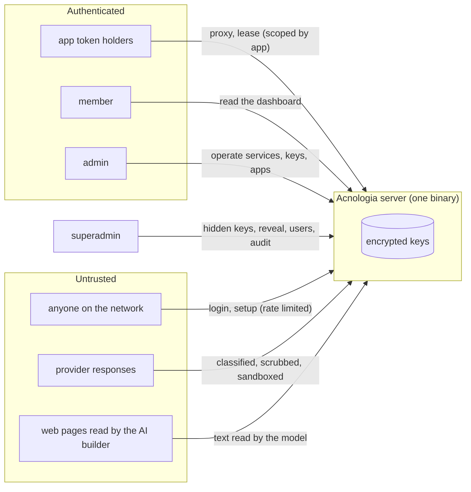
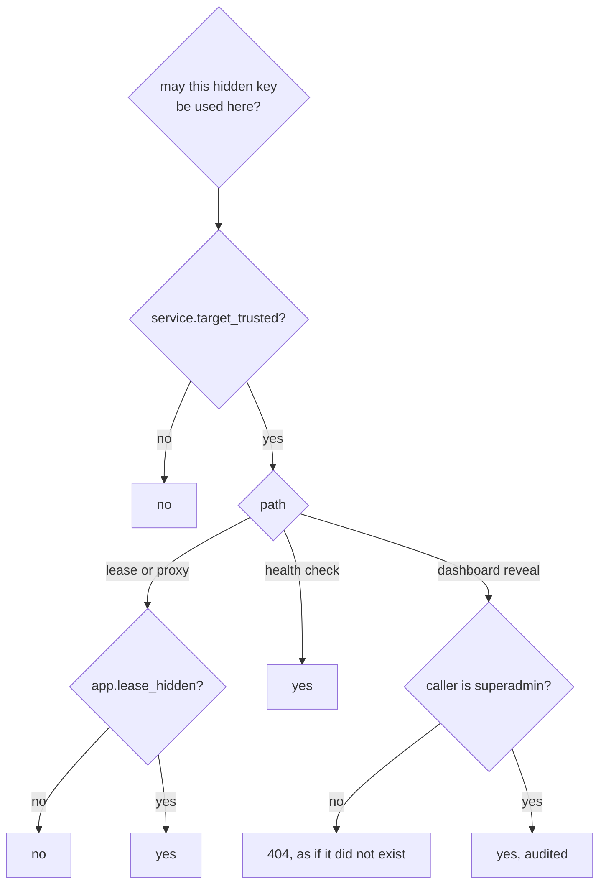
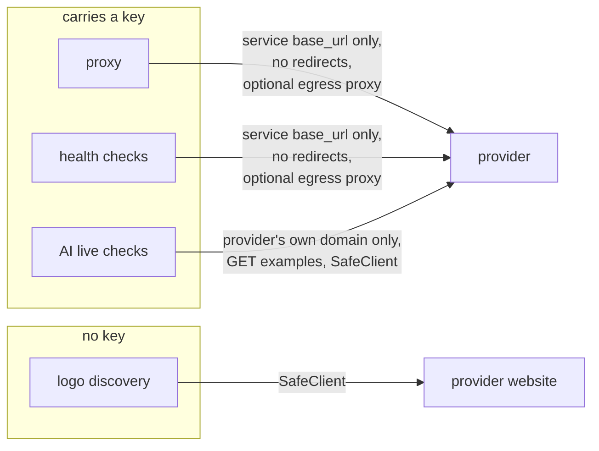

# Security model

Acnologia holds other people's API keys, so most of its design is about who can
make a key leave the server, and where it can go.

## Trust boundaries

## Roles

| Can | member | admin | superadmin |
|---|:-:|:-:|:-:|
| See services, non-hidden keys, events, apps, providers | yes | yes | yes |
| Add, edit, delete services, keys, apps, providers; run checks; AI runs | no | yes | yes |
| See, create, hide or delete **hidden** keys | no | no | yes |
| Let an app use hidden keys (`lease_hidden`) | no | no | yes |
| Reveal a key's secret in the dashboard | no | no | yes |
| Manage users, read the audit log, set AI rules | no | no | yes |

Roles are re-read from the database on every request, so a demotion or a
disable takes effect immediately. At least one active superadmin always
remains.

## Apps and key flags

Each app has its own token (stored as a hash), a list of services it may use
(empty means all) and a mode: `proxy`, `lease` or `both`. An app learns
whether a service has a key available, never how many keys exist.

Each key can carry flags:

- `hidden`: visible only to superadmins, and handed only to apps a superadmin
  cleared with `lease_hidden` (below).
- `restricted`: serves only the apps you name on the key.
- `disabled`: stays stored but is never handed out.
- `backup` tier: serves only when every primary key is cooling, busy or out
  of quota.

## Hidden keys: admins operate, but never read them

An admin can create apps and edit services. Leasing a key returns the plain
secret, and a proxied provider can echo the key back, so **any key an admin can
route to an app or a host they control is effectively readable by that admin**.
Non-hidden keys are therefore readable by admins. Use `hidden` for keys they
must never see. Two flags enforce this:

- **`apps.lease_hidden`**: only apps a superadmin marked may use hidden keys,
  through a lease or the proxy. Admins cannot set it. When anyone other than a
  superadmin rotates the app's token, the flag is cleared, because that person
  now holds the token.
- **`services.target_trusted`**: when anyone other than a superadmin changes a
  service's base URL, auth placement or provider, the service becomes
  untrusted, and hidden keys are not sent to it by the proxy, leases or health
  checks. A superadmin confirms the target by saving those fields again. The
  dashboard shows a banner while hidden keys are paused.

Hidden keys and their traffic are also left out of everything a non-superadmin
sees: key lists, counts, events, request totals, and the events of a deleted
hidden key.

## Secrets at rest

| Item | Stored as |
|---|---|
| Provider keys | AES-256-GCM with a random nonce per write, plus a keyed HMAC fingerprint for duplicate detection |
| AI run test keys | Same encryption, wiped when the run ends |
| Passwords | bcrypt (10 to 72 characters) |
| Session and app tokens | SHA-256 of 32 random bytes |
| Master key | `ACNOLOGIA_MASTER_KEY`, else `data/master.key` (0600, generated on first boot) |

The server refuses to start when the master key does not match the database
(checked through `meta.master_key_check`, or by decrypting a stored key on
databases from before that check). It never generates a new key over an
existing file it failed to read. The data directory is chmod 0700 and the
database files 0600.

## Keeping keys out of places people can read

- Upstream error text, health check errors and lease report messages are
  scrubbed of the key (raw, query escaped and path escaped forms) before they
  are stored in `last_error` or events, or logged.
- Request logs record the path only, never the query string.
- Proxied response headers are scrubbed of the key, so a redirect that keeps
  the query string cannot hand a query-auth key to the app.
- Requests that carry a key never follow redirects (Go would forward custom
  auth headers like `xi-api-key` to the new host).
- The SDKs scrub the secret from failure reports and redact it when a lease or
  client is printed.

## Assistant chat

- Tools call the dashboard API in process with your own session, so the
  assistant can never do more than you can, and its changes appear in the
  audit log under your name. Members are offered read tools only.
- Deleting keys, services or apps and rotating app tokens run only after you
  press Confirm; a confirmation expires when you send another message.
- There is no tool that reveals a stored key secret. Tool results sent to
  Claude never contain secrets, and new app tokens are shown to you once and
  never sent to Claude or stored.
- Keys you paste never reach Claude. Before a message goes to the model,
  Acnologia finds the keys in it (the paste parser, then the pattern detector
  for keys inside URLs, after `Bearer`, in JSON fields or glued to text),
  encrypts each one into the thread's vault and puts a placeholder such as
  `[key k3 ...c21e]` in its place. Tools resolve the placeholders on the
  server. Your own message is stored as the prose without the keys, plus a
  list of label and last four characters. Threads are encrypted at rest with
  the master key and visible only to their owner.
- Key account fields (email, phone, name) are personal data: members see them
  empty, and they are not written to events or the audit log.

## What the model can and cannot see

Every request to Anthropic, from the Assistant, the provider builder, Fill
with AI and run naming, goes through one HTTP middleware on the shared client
that rewrites the request body before it leaves the server:

- Known secrets are replaced by `[key ...c21e]`: every pool key, webhook URL
  and secret, and egress proxy URL (decrypted once into a multi pattern
  matcher and reloaded when one changes), plus `GITHUB_TOKEN`, the builder
  run's test keys and the keys a chat turn handled. Raw, query escaped and path escaped forms
  are matched. Values shorter than 8 characters are not matched exactly.
- Unknown secrets are replaced by `[secret ...c21e]` by pattern: common
  prefixes (`sk-ant-`, `sk-`, `AIza`, `ghp_`, `xox`, `tvly-`, `AKIA`,
  `sk_live_`, JWTs, Acnologia's own `acn_` and `acnadm_` tokens and the
  older `cog_` and `cogadm_` ones), `Bearer` and `Basic`
  credentials, auth headers, `key=`, `api_key=`, `token=`, `secret=` and
  `password=` in URLs, env lines and JSON, and long random looking tokens.
  Hex hashes, UUIDs, words, identifiers and paths are left alone.
- The system prompt, your messages and every tool result get both passes.
  Replayed model output gets the known pass only; thinking blocks and web
  search and fetch results are not touched, since the API checks their
  signatures. Tool definitions are not changed.

So Claude sees key hints, labels, statuses and quotas, but not a secret,
including a key an upstream echoes in an error or a live check. The builder's
live checks use the test key on the server; the model gets the result with
the key replaced.

The same redactor runs where text is stored or sent: agent steps and run
errors, run notes, events, the audit log, key `last_error`, webhook payloads
and delivery errors, and every log line (a wrapping `slog` handler).

Limits: a short key with no prefix and no `key=` in front of it (a bare 12
character token in a sentence) is caught only if it is already a pool key or
the paste parser finds it. Leasing a key, through the API or the MCP
`get_key` tool, returns the secret to the app by design; use proxy mode for
any client you would not hand a key to.

## Web protections

- **CSRF**: every mutating dashboard call must send `Content-Type:
  application/json` or `X-Requested-With`, both of which force a CORS
  preflight. This holds for bodyless calls too. The session cookie is
  `HttpOnly` and `SameSite=Lax`.
- **Content Security Policy**: the dashboard allows scripts only from itself
  plus the exact inline scripts in `index.html`, by SHA-256 hash computed at
  startup. Framing is denied.
- **Proxied responses** are served from the dashboard origin, so they get
  `Content-Security-Policy: sandbox; default-src 'none'`, `nosniff` and
  `X-Frame-Options: DENY`, and upstream `Set-Cookie`, CORS and security
  headers are dropped.
- **Logos** are served with their sniffed type, `nosniff` and a sandbox CSP,
  and the UI only ever shows them through ``.
- **Links** from provider data are rendered only when they are `http(s)`, and
  the server rejects other schemes for provider `website` and `docs_url`.

## Abuse limits

| Limit | Value |
|---|---|
| Failed logins | 10 per 10 minutes per client IP and per existing account |
| Dashboard JSON body | 4 MB |
| Proxy request body | `ACNOLOGIA_MAX_BODY_MB` (default 50) |
| Proxy methods | GET, HEAD, POST, PUT, PATCH, DELETE, OPTIONS |
| Proxy idle stream | 5 minutes without bytes ends the response and frees the slot |
| Cooldown from a report or `Retry-After` | 24 hours |
| Lease wait / TTL | 60 s / 24 h |
| Late lease report | refused 10 minutes after expiry |
| MCP tool result | `max_result_kb` per app, default 200 KB, at most 2048 |
| AI runs | 2 at a time, 40 turns, 30 minutes, 5 live checks, 3 submits |
| Assistant | 24 model steps and 15 minutes per message, messages up to 1 MB (a dropped file of keys), one message at a time per chat |

The client IP comes from the socket unless `ACNOLOGIA_TRUST_PROXY_HEADERS=true`.
Behind a reverse proxy, enable it, or every client shares one login limit.

## Outbound requests

Webhook deliveries carry no key and go through `SafeClient` unless
`ACNOLOGIA_WEBHOOK_ALLOW_PRIVATE=true`. Webhook URLs are encrypted at rest (Slack,
Discord and Telegram URLs are secrets) and only a host hint is ever returned.
Hidden keys never produce webhook events.

An egress proxy sees which hosts keys travel to, and the keys themselves when
a service's base URL is plain `http`. Assigning one is therefore part of a
service's target: a non-superadmin assigning or changing it clears
`target_trusted`, so hidden keys stop flowing until a superadmin confirms.
Proxy URLs are encrypted at rest and shown without credentials.

The response cache is shared by the apps of a service, so Acnologia never caches
a response made with a hidden or restricted key, a response the upstream marks
`private` or `no-store`, or a body that contains the key. Idempotent replays
are stored per app.

Admin API tokens (`acnadm_`) are stored as SHA-256 hashes, carry a scope that
never exceeds their owner's role, stop working when the owner is disabled, and
cannot create tokens or change the account.

`SafeClient` checks the resolved address at dial time, which also defeats DNS
rebinding, and refuses loopback, private, link local (including cloud metadata
at 169.254.169.254), CGNAT, benchmark, documentation and reserved ranges, plus
NAT64 and 6to4 addresses that embed one of those.

The AI builder's `web_search` and `web_fetch` run on Anthropic's side, so
fetched pages never reach Acnologia's network. Its `github_read` tool validates
owner, repo and path. Text from fetched pages can steer the model, so its
output is checked rather than trusted: the harness re-validates and re-tests
every submitted spec, a create run cannot overwrite an existing provider,
update runs wait for review by default, and the test key only goes to the
provider's own domain.

## Operator checklist

1. Serve over TLS and set `ACNOLOGIA_SECURE_COOKIES=true`.
2. Behind a reverse proxy, set `ACNOLOGIA_TRUST_PROXY_HEADERS=true`.
3. Set `ACNOLOGIA_MASTER_KEY` from a secret store instead of keeping
   `master.key` on the data volume, and back it up. Losing it makes stored keys
   unreadable.
4. Do the first run setup right away, or set `ACNOLOGIA_BOOTSTRAP_EMAIL` and
   `ACNOLOGIA_BOOTSTRAP_PASSWORD`, so nobody else can claim the superadmin.
5. Mark keys admins must never see as `hidden`, and grant `lease_hidden` only
   to apps that need them.
6. Use a fine grained, public read only `GITHUB_TOKEN` if you set one.

## Known limitations

- Docker base images are pinned by tag, not digest.
- Ciphertexts are not bound to their row, so someone with write access to the
  database could swap secrets between keys.
- Proxy request bodies are buffered in memory up to the body limit.
- The per account login limit means ten wrong passwords lock that account for
  10 minutes.
